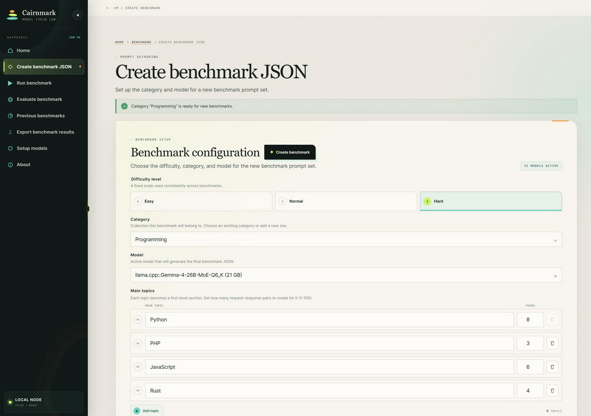

# Cairnmark

> A private, local workspace for chatting with AI models and building reusable
> benchmark prompt sets.

**Preview release · single user · localhost only**

Created by Primere Development · [GitHub repository](https://github.com/CosmicLaca/Cairnmark)

**Special features:** llama.cpp focus · All llama parameters · Context metering ·
Manual compaction · Auto compact · Many API providers · MinerU support ·
Multimodal chat · Chat import/export · Local benchmarks · Encrypted API keys

## What you can do

Cairnmark brings local and hosted model providers into one browser interface.
Use it to:

- chat with enabled models, attach files, and save, import, or export conversations;
- shorten long chats with manual or automatic context compaction;
- generate benchmark JSON from topics and custom instructions;
- organize, filter, preview, and edit benchmark files; and
- run benchmark requests and save answers, response times, and optional logs.

Your benchmark files, settings, and chat history remain on your computer.
Requests sent to hosted models are still subject to that provider's terms and
privacy policy.

> Evaluation, benchmark result history and export, accounts, and hosted
> multi-user use are not available in this preview.

## Quick start

### Requirements

- Python 3.14;
- a running local model server or an API key for a hosted provider;
- Git, if you clone the repository; and
- FFmpeg on `PATH` if you want video or audio conversion.

### Windows 11

```powershell
git clone https://github.com/CosmicLaca/Cairnmark.git
cd Cairnmark
python -m venv venv
.\venv\Scripts\activate
python -m pip install -r requirements.txt
.\run.bat
```

### Linux

```bash
git clone https://github.com/CosmicLaca/Cairnmark.git
cd Cairnmark
python3 -m venv venv
source venv/bin/activate
python -m pip install -r requirements.txt
./run.sh
```

Open [http://127.0.0.1:5000](http://127.0.0.1:5000). Keep the launcher
terminal open and press **Ctrl+C** to stop Cairnmark.

To use a different port, set `PORT` before starting:

```powershell
$env:PORT = "5050"
.\run.bat
```

```bash
PORT=5050 ./run.sh
```

Cairnmark intentionally listens only on `127.0.0.1`. It is a local,
single-user application, not a network service.

## Your first session

1. Open **Setup models** and connect a provider.
2. Enable the provider and at least one discovered model.
3. Open **Home**, select the model, and send a test message.
4. Open **Create benchmark JSON** and generate a small prompt set.
5. Open **Run benchmark**, select the file and model, then start the run.

## Connect a model

<p align="center"></p>

| Provider | How models are found |
| --- | --- |
| **llama.cpp** | Connect a local server and save one or more discovered models |
| **vLLM** | Connect a local server; Cairnmark reads its single loaded model live |
| **OpenRouter, OpenAI, Google Gemini, Anthropic, Mistral** | Save an API key and fetch the provider's catalog |
| **DeepSeek, OpenCode, OpenCode-ZEN, Z.ai, Grok** | Save an API key and fetch the provider's catalog |

To connect:

1. Select a provider on **Setup models**.
2. Enter its local endpoint or API key.
3. Fetch and save the available models.
4. Turn on the provider and the models you want to use.

A model appears elsewhere only while its provider and model are enabled.
Cairnmark turns off an unreachable provider. vLLM has no separate model switch
because its loaded model is read live.

Hosted-provider keys are encrypted before they are stored and are never sent
back to the browser after saving.

## Chat on Home

<p align="center"></p>

Choose a model, adjust the system prompt or generation controls if needed, then
select **Send**. While a response is being generated, **Abort** requests
cancellation.

**Save setup** remembers the main chat choices for the next page load: model,
system prompt, temperature, top p, top k, seed, and recent-message limit.
Additional local-model parameters are managed separately per model.

### Stream responses

Use the **Stream responses** switch at the right of the attachment row to choose
how an assistant response is displayed while it is being generated. When the
switch is off, the response bubble shows an increasing character count until
the response is complete. When it is on, arriving content is rendered in the
bubble as formatted Markdown; complete table rows are displayed as they arrive
instead of exposing their Markdown source.

The switch is off until a value has been saved. Its current value is saved when
you select **Send** and restored on the next page load.

### Use llama.cpp parameters and context sizes

For llama.cpp models, changing **Active model for the chat** checks only the
local parameter database. It does not wait for the model server's `/props`
response. The status light inside **Set more parameters** shows what is already
saved for the selected model and the current llama.cpp context mode:

- red: generation parameters and context data have not been saved;
- orange: parameters exist, but `n_ctx` is missing for the current mode; and
- green: parameters and the current mode's `n_ctx` value both exist.

Hover over the light for the exact status. Cairnmark stores context sizes by
mode in `n_ctx_modes`, so the same model can retain separate values for
`fit_on`, `fit_off`, and `n_ctx` operation.

Select **Set more parameters** to open the modal. Existing data is shown
immediately. If parameters or the current mode's context size are missing,
Cairnmark then reads `/props?model=[model_id]` from the local llama.cpp server
and saves the returned data in `instance/parameters.db`. Previously saved
parameter data is kept when only a new mode's `n_ctx` value is required.

The modal lets you choose which values are **SET** or **UNSET** for subsequent
requests. **Delete from local DB** removes the cached row and immediately reads
and saves fresh data from the server.

### Control conversation context

**Prev. messages** controls how much recent history is sent with the next
request. Its switch sends all previous messages instead. The counters beside
this field and above the message box show the selected tokens against the
model's known maximum:

- green: up to 75%;
- orange: over 75% and up to 95%; and
- red: over 95%, which disables **Send**.

Use **Compact chat** to ask the selected model for a shorter summary of the
active context. The summary appears immediately as a light-red,
Markdown-rendered **compacted summary** and becomes the boundary for later
conversation history.

The switch inside **Compact chat** enables automatic compaction. When it is on,
Cairnmark starts the same compaction process after a successful response pushes
the selected context above 75%. The switch is off by default and its current
value is saved when you send a message.

Older messages remain visible after compaction, but they are no longer included
before the summary in future model requests.

### Attach files

The document button is always available. Image, video, and audio buttons appear
when the selected local model reports those capabilities.

| Type | What Cairnmark does |
| --- | --- |
| **Image** | Resizes large images before sending |
| **Video** | Converts to MP4 and uses the selected frame rate |
| **Audio** | Converts to a compact MP3 when FFmpeg is available |
| **Document** | Sends text files directly or converts supported binary files through MinerU |

You can attach up to eight files, with a maximum submitted size of 100 MB each.
Video controls can include audio analysis, a saved local preview, and an FPS
choice. Lower FPS values send fewer frames.

For PDF, Office, EPUB, and other binary documents, configure MinerU by
right-clicking the document button—or selecting it when no endpoint is saved.
Enter the MinerU endpoint and optional key, then save after the connection
check succeeds.

### Save useful conversations

- **Save chat** stores the current conversation under a name.
- **Saved chats** loads or deletes an earlier conversation.
- **Replace chat** updates the currently selected saved conversation.
- **Clear chat** starts a fresh conversation.
- System prompts can be saved, loaded, and removed separately.

### Import and export conversations

Select **Export chat** to write a complete, import-ready JSON document to
`Exported-chat/`. With no saved conversation selected, Cairnmark exports the
active conversation from the chat database as
`Exported-main-[date_time].json`. When **Saved chats** contains a selected
conversation, Cairnmark exports that saved database record instead and uses
`Exported-[normalized_chat_name]-[date_time].json`. Spaces and characters that
are unsafe in filenames are normalized automatically. An empty active chat
cannot be exported.

Select **Import chat** and choose a Cairnmark chat-export `.json` file. A valid
import clears the current conversation, restores every exported message in the
chat body, and replaces the rows in the active `chat_messages` table. Message
roles, content, timestamps, model metadata, token usage, attachment metadata,
and compaction state are retained by the export format. Import does not overwrite
a named entry in **Saved chats**; the imported conversation becomes the active
chat and can be saved under a name afterward. Cairnmark shows an alert only if
the import fails.

## Create a benchmark

<p align="center"></p>

On **Create benchmark JSON**:

1. Choose or create a category.
2. Select Easy, Normal, or Hard.
3. Choose an enabled model.
4. Add topics and the number of prompt/response pairs for each topic.
5. Optionally customize the generation instructions.
6. Select **Create benchmark** and keep the page open until it finishes.

Cairnmark saves the generated JSON in `Benchmark-prompts/` and adds its
metadata to the benchmark browser.

## Browse and edit benchmark files

<p align="center"></p>

Open **Run benchmark** to find files by category or difficulty, preview their
contents, and edit metadata such as notes and source-model information.

You can also copy existing `.json` files directly into
`Benchmark-prompts/`. Files must be in that directory—not a nested folder—and
must use the supported structure. Imported files without metadata appear under
**Uncategorized** with **Normal** difficulty.

## Run a benchmark

<p align="center"></p>

1. Open a benchmark from **Run benchmark**.
2. Choose an enabled model.
3. Review the benchmark system prompt.
4. Optionally enable **Create log**.
5. Start the run and keep the page open.

Requests run one at a time. Cairnmark sends the `request` text to the model,
never the reference `response`. Each answer and its response time are appended
to the source JSON without removing unknown fields. Optional Markdown logs are
written to `Benchmark-prompts/logs/`.

A minimal benchmark looks like this:

```json
[
  {
    "Networking": {
      "benchmarks": [
        {
          "request": "Which OSI layer provides end-to-end flow control?",
          "response": "The transport layer (Layer 4)."
        }
      ]
    }
  }
]
```

## Local data and backups

| Location | Contents |
| --- | --- |
| `Benchmark-prompts/` | Benchmark JSON and recorded answers |
| `Benchmark-prompts/logs/` | Optional run logs |
| `System-prompts/` | Editable default prompt templates |
| `instance/cairnmark.db` | Provider settings, benchmark metadata, and interface preferences |
| `instance/chathistory.db` | Current and saved chats and system prompts |
| `instance/parameters.db` | Saved local-model generation defaults |
| `instance/preview/` | Chat attachment previews |
| `Exported-chat/` | Import-ready chat JSON exports |
| `.secret/` | The key used to encrypt saved API credentials |

For a complete backup, stop Cairnmark and copy `Benchmark-prompts/`,
`System-prompts/`, `Exported-chat/`, `instance/`, and `.secret/` together. Keep
`instance/cairnmark.db` paired with its original `.secret/` directory or
saved API keys cannot be decrypted.

Do not publish these directories. They can contain credentials, private
prompts, attachments, and model responses.

## Troubleshooting

### A model is missing

Check that the provider configuration is saved, reachable, and enabled. For
catalog providers, also enable the individual model. For vLLM, confirm the
server has a model loaded.

### A benchmark file is missing

Confirm that the file:

- ends in `.json`;
- is directly inside `Benchmark-prompts/`; and
- contains valid JSON in the documented structure.

Correct the file, then reload the page.

### Media conversion fails

Install the FFmpeg executable and confirm that `ffmpeg` is available on
`PATH` in the same terminal used to start Cairnmark.

### Port 5000 is busy

Stop the process already using the port or set a different `PORT` before
running the launcher.

For more diagnostic detail, start Cairnmark with
`CAIRNMARK_LOG_LEVEL=DEBUG`. Provider keys and request content are excluded
from application logs.

## Development

Show unfinished placeholder pages locally:

```powershell
.\venv\Scripts\python.exe app.py --dev
```

Run the isolated automated tests:

```powershell
.\venv\Scripts\python.exe -m pytest -q
```

```bash
venv/bin/python -m pytest -q
```

## License

Copyright (c) 2026 Primere Development. All rights reserved.
