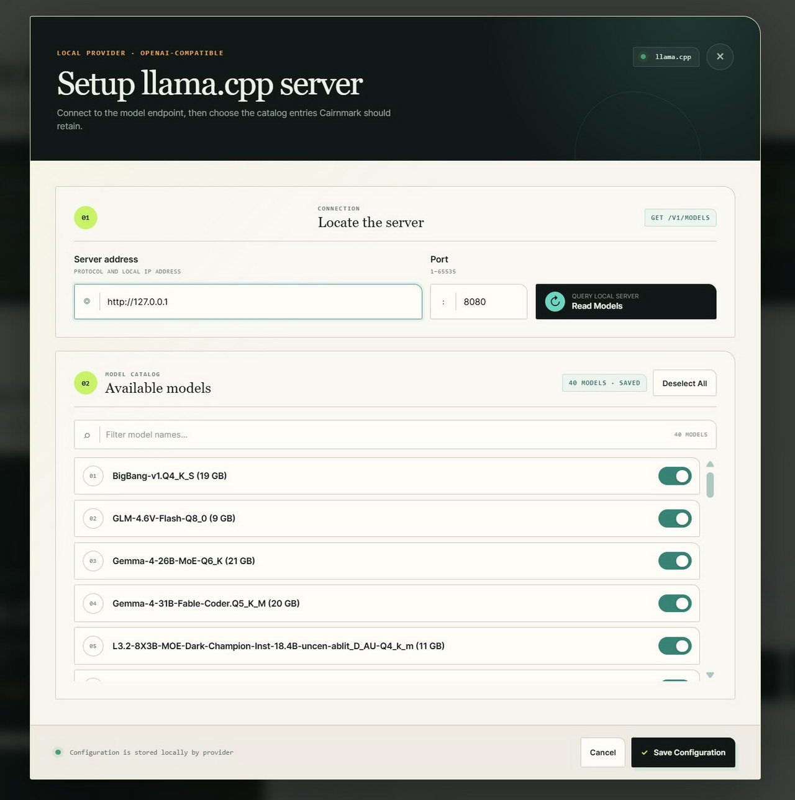

# Cairnmark

> A private, local workspace for chatting with language models and creating,
> organizing, running, and reviewing benchmark prompt sets.

**Preview release · single user · localhost only**

Created by Primere Development · [GitHub repository](https://github.com/CosmicLaca/Cairnmark)

---

## Start here

Cairnmark connects local and hosted AI models in one browser interface. It can:

- chat with an enabled model and save conversations and system prompts;
- generate benchmark JSON from topics and instructions;
- organize benchmark files by category and difficulty;
- run every request in a benchmark against a selected model; and
- save model answers, timing data, and optional Markdown logs locally.

Benchmark files remain readable JSON. Settings, metadata, and chat history are
stored in local SQLite databases. Provider API keys are encrypted at rest.

> **Important:** Evaluation, result history, and export are under development.
> They are visible only when Cairnmark starts with `--dev` and are not working
> product features yet.

## Contents

- [Install and run](#install-and-run)
- [First-use workflow](#first-use-workflow)
- [Set up models](#set-up-models)
- [Use chat](#use-chat)
- [Create a benchmark](#create-a-benchmark)
- [Organize and inspect benchmarks](#organize-and-inspect-benchmarks)
- [Run a benchmark](#run-a-benchmark)
- [Benchmark JSON format](#benchmark-json-format)
- [Files, privacy, and backups](#files-privacy-and-backups)
- [Troubleshooting](#troubleshooting)
- [Developer notes](#developer-notes)
- [Roadmap](#roadmap)
- [License](#license)

## Install and run

You need Python 3.14, Git if cloning the repository, and at least one local
model server or hosted-provider API key.

### Windows 11

```powershell
git clone https://github.com/CosmicLaca/Cairnmark.git
cd Cairnmark
python -m venv venv
.\venv\Scripts\activate
python -m pip install -r requirements.txt
.\run.bat
```

### Linux

```bash
git clone https://github.com/CosmicLaca/Cairnmark.git
cd Cairnmark
python3 -m venv venv
source venv/bin/activate
python -m pip install -r requirements.txt
./run.sh
```

Open [http://127.0.0.1:5000](http://127.0.0.1:5000). Keep the launcher terminal
open; press **Ctrl+C** to stop the application.

To use another port:

```powershell
$env:PORT = "5050"
.\run.bat
```

```bash
PORT=5050 ./run.sh
```

## First-use workflow

1. Open **Setup models** and configure a provider.
2. Enable the provider and at least one discovered model.
3. Use **Home** to test the model in chat.
4. Open **Create benchmark JSON**, choose topics, and generate a benchmark.
5. Open **Run benchmark** to review its metadata and contents.
6. Select **Create benchmark** on its card, choose a model, and run it.
7. Inspect the appended `answers` entries or optional Markdown log.

## Interface map

| Page | What it does |
| --- | --- |
| **Home** | Chat, attachments, saved chats, prompts, and generation settings |
| **Create benchmark JSON** | Generate a new benchmark from topics and instructions |
| **Run benchmark** | Filter, inspect, organize, edit, and run benchmark files |
| **Setup models** | Configure providers and enable models |
| **About** | Display this manual inside Cairnmark |

The sidebar can collapse to an icon rail. In expanded mode, drag its right edge
to resize it, use arrow keys while the resize handle is focused, or double-click
the handle to restore its default width. The browser remembers the layout.

## Set up models


Cairnmark supports two local providers and ten hosted providers.

| Provider | Setup |
| --- | --- |
| llama.cpp | Local address and port; discovers and saves multiple models |
| vLLM | Local address and port; reads the single loaded model live |
| OpenRouter, OpenAI, Google Gemini, Anthropic, Mistral | API key and discovered catalog |
| DeepSeek, OpenCode, OpenCode-ZEN, Z.ai, Grok | API key and discovered catalog |

For each provider:

1. Select its card on **Setup models**.
2. Enter the local endpoint or hosted API key.
3. Fetch the model catalog and save the configuration.
4. Switch on the provider.
5. For providers with saved catalogs, switch on the models you want to use.



A model appears elsewhere only when both its provider and model switch are
enabled. An unreachable provider cannot remain enabled. vLLM is different: its
loaded model is queried live and has no separate saved model switch.

API keys are never returned to the browser after saving. They are encrypted in
`instance/cairnmark.db` using the key in `.secret/`.

## Use chat


Open **Home**, select an active model, enter a message, and choose **Send**.
During generation, **Abort** requests cancellation.

### Generation controls

The setup controls include the system prompt, temperature, top p, top k, seed,
and recent-message limit. **Save setup** stores only these standard fields as
the next page-load defaults. Additional model parameters are temporary:

- **Save** in the parameter dialog keeps them for following requests on the
  current page;
- **Cancel** removes them; and
- deleting cached local defaults makes the next dialog open read them again
  from the local provider.

Only allowlisted sampling fields are forwarded to llama.cpp and vLLM. Hosted
providers ignore additional local-model parameter values.

### Attachments and saved data

Documents are always available. Image, video, and audio controls appear when a
selected local model reports the matching capability. Large images are resized
before sending. Attached video is re-encoded to MP4, scaled to a 480-pixel
maximum side, 2 frames per second, and lower quality before sending. Its audio
track is dropped by default; use the "Attach audio" switch to keep it. Attached
audio is converted to a 64 kbit/s MP3 when needed. Attachments up to 100 MB
are accepted. Small image previews are
stored in `instance/preview/`; only their filenames are stored in chat history.

- **Save chat** stores or replaces a named conversation.
- **Saved chats** loads or deletes stored conversations.
- **Clear chat** clears the current conversation.
- Saved system prompts can be created, loaded, and deleted separately.

## Create a benchmark


Open **Create benchmark JSON** and complete these fields:

1. **Category** — select one or create a new category.
2. **Difficulty** — choose Easy, Normal, or Hard.
3. **Model** — select an enabled `provider::model` entry.
4. **Topics** — add topic names and pair counts (1–100 per topic).
5. **Prompt customization** — optionally edit the system prompt and creation
   details shown before generation.

Select **Create benchmark**. Progress is reported as the model completes topics
and pairs. On success, Cairnmark atomically saves the JSON, records its metadata,
and shows it on **Run benchmark**.

Generated filenames retain the application's historical spelling:

```text
Benchamrk-prompts-YYYYMMDDHHMM-Category-Difficulty.json
```

## Organize and inspect benchmarks


Place imported `.json` files directly in `Benchmark-prompts/` and reload **Run
benchmark**. Nested directories are not scanned.

Use category tabs and difficulty controls to filter cards. A file without saved
metadata appears under **Uncategorized** with **Normal** difficulty.

- Select the filename area to edit category, difficulty, notes, generation
  prompt, and source model metadata.
- Select **View benchmark** to open its request-response accordion.
- Edit a reference response in the preview when correction is needed.
- Metadata changes do not move or rewrite the benchmark file.

## Run a benchmark


Select **Create benchmark** on a benchmark card.

1. Choose an enabled model.
2. Review the prompt loaded from `System-prompts/run_benchmark-SYSTEM.md`.
3. Optionally enable **Create log**.
4. Select **Run benchmark** and leave the page open until it finishes.

Cairnmark processes requests sequentially. It sends only the `request` text and
processed system prompt. The expected `response` and all other benchmark keys
are withheld from the model.

Each result is appended to the request's `answers` array:

```json
{
  "model_name": "provider::model",
  "model_answer": "The model output",
  "response_time": 3
}
```

The source JSON is replaced atomically and unrelated keys are preserved. If
logging is enabled, a readable `.md` file is written under
`Benchmark-prompts/logs/`.

## Benchmark JSON format

Cairnmark expects a top-level array of named topic objects. Each topic contains
a `benchmarks` array:

```json
[
  {
    "Networking": {
      "benchmarks": [
        {
          "request": "Which OSI layer provides end-to-end flow control?",
          "response": "The transport layer (Layer 4).",
          "answer_type": "short_text"
        }
      ]
    }
  }
]
```

Extra keys such as `answer_type` are allowed and preserved when results save.

## Files, privacy, and backups

| Location | Contents |
| --- | --- |
| `Benchmark-prompts/` | Benchmark JSON and appended run answers |
| `Benchmark-prompts/logs/` | Optional run logs |
| `System-prompts/` | Editable default prompt templates |
| `instance/cairnmark.db` | Metadata, providers, encrypted keys, chat defaults |
| `instance/chathistory.db` | Current and saved chats and system prompts |
| `instance/parameters.db` | Cached local-model generation defaults |
| `instance/preview/` | Image previews used by chat history |
| `.secret/` | Local API-key encryption key |

Cairnmark binds to `127.0.0.1` and is designed for one user on one machine.
Content sent to hosted models remains subject to that provider's policies.

For a complete backup, stop Cairnmark and copy `Benchmark-prompts/`,
`System-prompts/`, `instance/`, and `.secret/` together. The database and
encryption key must stay paired. Do not publish these directories.

## Troubleshooting

### A model does not appear

Confirm the configuration is saved, the provider is reachable and enabled, and
the model switch is enabled. For vLLM, confirm its server has one model loaded.

### A JSON file does not appear or display

Confirm that it has a `.json` extension, is directly in `Benchmark-prompts/`,
and contains valid JSON in the documented shape. Reload the page afterward.

### Port 5000 is already in use

Stop the earlier process or launch on another `PORT`, as shown above.

### Enable debug logging

```powershell
$env:CAIRNMARK_LOG_LEVEL = "DEBUG"
.\run.bat
```

```bash
CAIRNMARK_LOG_LEVEL=DEBUG ./run.sh
```

Provider keys and request content are not written to application logs.

## Developer notes

Show unfinished pages locally with:

```powershell
.\venv\Scripts\python.exe app.py --dev
```

Run tests with isolated databases and benchmark directories:

```powershell
.\venv\Scripts\python.exe -m pytest -q
```

```bash
venv/bin/python -m pytest -q
```

`app.py` owns the Flask factory, `routes.py` declares URLs, controllers translate
HTTP requests, services own business and provider protocol rules, and models own
SQLite. Benchmark filesystem operations live in
`services/benchmark_documents.py`.

## Roadmap

The following are planned, not available:

- evaluate recorded answers against reference responses;
- browse previous runs and scores; and
- export benchmark results.

Authentication, hosted multi-user deployment, and production service mode are
outside the current local, single-user scope.

## License

Copyright (c) 2026 Primere development. All rights reserved.

Cairnmark is proprietary software developed by **Primere development** (the
"Developer"). The source is visible for inspection, but Cairnmark is not
open-source software. By installing or running it, you accept the terms below.

### Summary

| You may | You may not |
| --- | --- |
| Install and run Cairnmark on one machine, locally, at no cost and without time or usage limits | Run it on more than one machine under one grant, or give anyone else access to it |
| Use it yourself, including for your own professional work | Share an instance between users, including through a cloud, hosted or shared-service setup, or over an internal network |
| Use the application's own settings and edit your benchmark files, prompts and results | Modify, adapt or create derivative works of the software |
| Keep a private backup copy | Redistribute, sell, lease or sublicense it, or offer it as a paid service |

The terms below are authoritative.

1. **Grant.** The Developer grants you a non-exclusive, non-transferable,
   revocable license to install and run one copy of Cairnmark on one machine,
   locally, for one user. The license is free of charge and has no time or
   usage limit.
2. **Single machine, single user.** Only the person who runs Cairnmark may use
   it, and only on the machine where it is installed. You may not make an
   instance available to other people in any form: not over the internet, not
   over a local or internal network, not as a hosted, cloud or shared service,
   and not through remote-access, tunneling or proxy setups that give others
   access to it.
3. **No modification.** You may not modify, adapt, translate, reverse engineer,
   or create derivative works of Cairnmark, in whole or in part, and you may not
   remove or alter copyright notices. Only the Developer may modify and release
   Cairnmark. The following is not modification: configuring Cairnmark through
   its own interface, editing the prompt template files in `System-prompts/`,
   and creating or editing your own data (benchmark files, logs and the local
   databases it manages).
4. **No redistribution.** You may not copy, publish, sublicense, sell, lease,
   lend or otherwise distribute Cairnmark or any part of it, except for the
   installed copy and a private backup copy for your own use.
5. **No paid service.** You may not offer Cairnmark, or access to it, as a paid
   or otherwise commercial service. This includes selling, renting or charging
   for access, bundling it into a paid product, and operating it as a hosted or
   managed service.
6. **Your data.** The benchmark files, prompts, answers, logs and results you
   create belong to you. This license covers the software only. Content you
   send to or receive from model providers is subject to those providers'
   terms.
7. **Third-party components.** The packages listed in `requirements.txt` are
   licensed by their respective authors under their own terms. This license does
   not change those terms.
8. **Termination.** The license ends automatically if you breach these terms.
   You must then stop using Cairnmark and delete all copies.
9. **No warranty.** Cairnmark is provided "as is", without warranty of any
   kind, express or implied, including merchantability, fitness for a
   particular purpose and non-infringement.
10. **Limitation of liability.** To the extent permitted by law, the Developer
    is not liable for any damages, including data loss or incorrect benchmark
    results, arising from the use of or inability to use Cairnmark.
11. **Reservation of rights.** All rights not expressly granted are reserved by
    the Developer. For other licensing, such as multi-user, team or commercial
    use, contact Primere development at `[contact e-mail or URL]`.
