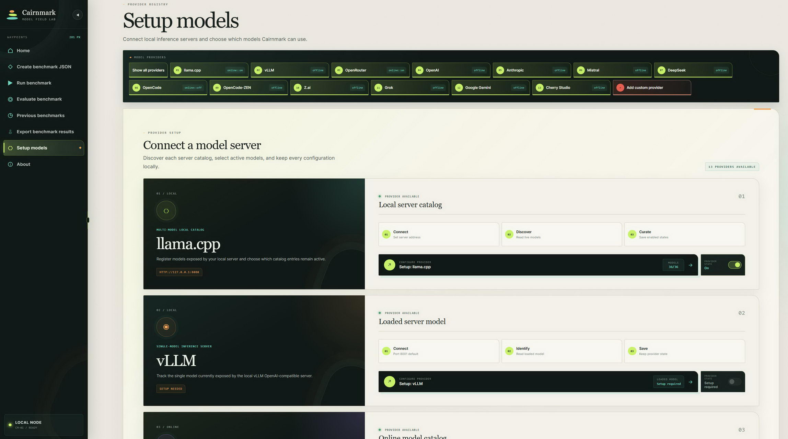
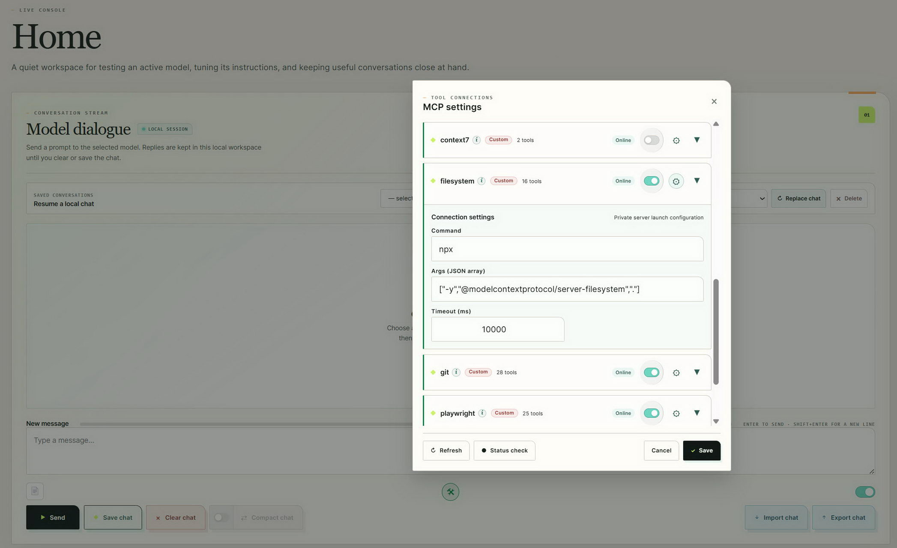

# CairnMark

---

> A private, localhost workspace for chatting with AI models and building
> reusable benchmark prompt sets.

**Preview release · single user · local data**

Created by **Primere Development** · [GitHub repository](https://github.com/CosmicLaca/CairnMark)

CairnMark brings local and hosted model providers into one browser interface.
It is designed for model comparison work that should remain inspectable: saved
provider state, request bodies, chat context, benchmark JSON, and optional logs
stay available on the local machine.

---

> ### Why is it special?
>
> - Durable failed responses
> - Per-response request body inspection
> - llama.cpp and CairnMark-managed MCP side by side
> - Optional MCP import and update from OpenCode
> - Stateful stdio MCP sessions
> - Generated-document download cards
> - Manual and auto context compaction
> - Per-model capability flags (media and tools)
> - Video FPS control and separated audio analysis
> - Local (or remote) MinerU document processing
> - Chat attachments accordion with media index
> - Reverse image search shortcuts
> - Webpage link screenshots
> - Inline image, audio and video previews
> - Per-service provider filter in model selector lists
> - AI-generated benchmark JSON
> - Benchmark runs keep expected answers local
> - Localhost-only binding, local SQLite and JSON data

---

## Main features

---

### Model setup

<!-- Screenshot placeholder: replace manual/setup-models.jpg with the preferred overview image. -->


Connect llama.cpp, vLLM, major hosted APIs, or a custom OpenAI-compatible
endpoint. Discover catalogs, save individual model switches, check live
reachability, recognize provider state from the numbered selector markers, and
keep hosted API keys encrypted at rest.

> Details:
> ### **[Model provider setup and troubleshooting →](manual/model-setup.md)**

---

### Chat workspace

<!-- Screenshot placeholder: replace manual/homepage.jpg with the preferred overview image. -->


Chat with any enabled model using saved system prompts, generation controls,
streaming Markdown, attachments, context metering, manual or automatic
compaction, and reusable conversations. Import/export and local media previews
support longer debugging sessions; failed requests remain visible as durable
diagnostic responses, and public images and webpage links gain visual tools.

> Details:
> ### **[Chat, attachments, context, and saved conversations →](manual/chat.md)**

---

### MCP tools

<!-- Screenshot placeholder: add manual/mcp-settings.jpg after capturing the final tool modal. -->


Use llama.cpp-managed or CairnMark-managed MCP connections. Global, service,
and subtool switches limit what a capable model can call. Global execution
limits, policies, runtime guidance, and webpage-preview controls are saved
locally; used tools remain identifiable on their response bubbles.

> Details:
> ### **[MCP tool handling →](manual/mcp-tools.md)** **[Local SearXNG setup and direct tests →](./manual/tool-setup.md)**

---

### Benchmark creation and checking

<!-- Screenshot placeholder: replace manual/create-benchmark.jpg with the preferred overview image. -->
<p align="left"></p>

Generate benchmark JSON from topics and custom prompts, organize files by
category and difficulty, preview or edit metadata, then run every request
against an enabled model. Answers and response times are appended atomically
without removing unknown evaluation fields.

> Details:
> ### **[Benchmark creation, browsing, and execution →](manual/benchmarks.md)**

---

## Feature overview

| Area | Highlights |
| --- | --- |
| Providers | llama.cpp, vLLM, hosted APIs, custom endpoints, live state markers |
| Chat | Streaming, durable failed responses, multimodal and webpage previews |
| Tools | Global execution policy, encrypted settings, cached discovery, used-tool markers |
| Benchmarks | AI-assisted JSON creation, metadata, filtering, preview, atomic result writes |
| Local data | SQLite settings/history, user-owned JSON, editable prompt templates |

Evaluation, benchmark result history/export, accounts, and hosted multi-user use
are not implemented in this preview. Development-only pages are not working
features.

---

## Quick start

Requirements: Python 3.14, a local model server or hosted-provider API key, and
FFmpeg on `PATH` for audio/video conversion.

### Windows 11

```powershell
git clone https://github.com/CosmicLaca/CairnMark.git
cd CairnMark
python -m venv venv
.\venv\Scripts\activate
python -m pip install -r requirements.txt
.\run.bat
```

### Linux

```bash
git clone https://github.com/CosmicLaca/CairnMark.git
cd CairnMark
python3 -m venv venv
source venv/bin/activate
python -m pip install -r requirements.txt
./run.sh
```

Open [http://127.0.0.1:5000](http://127.0.0.1:5000). CairnMark intentionally
binds only to `127.0.0.1`.

> Details:
> ### **[Installation, backups, troubleshooting, and development →](manual/getting-started.md)**

---

## First workflow

1. Configure and enable a provider on **Setup models**.
2. Select a model on **Home** and send a test message.
3. Generate a small prompt set on **Create benchmark JSON**.
4. Preview and run it from **Run benchmark**.

Your benchmark files, settings, and chat history remain on your computer.
Requests sent to hosted models are still governed by that provider's terms and
privacy policy.

---

## Manual index

> ### - [Installation, local data, backups, and development](./manual/getting-started.md)
> ### - [Model provider setup](./manual/model-setup.md)
> ### - [Chat workspace](./manual/chat.md)
> ### - [MCP tool handling](./manual/mcp-tools.md)
> ### - [MCP tool and local SearXNG setup](./manual/tool-setup.md)
> ### - [Benchmark workflow](./manual/benchmarks.md)

---

## License

Copyright (c) 2026 Primere Development. All rights reserved.
