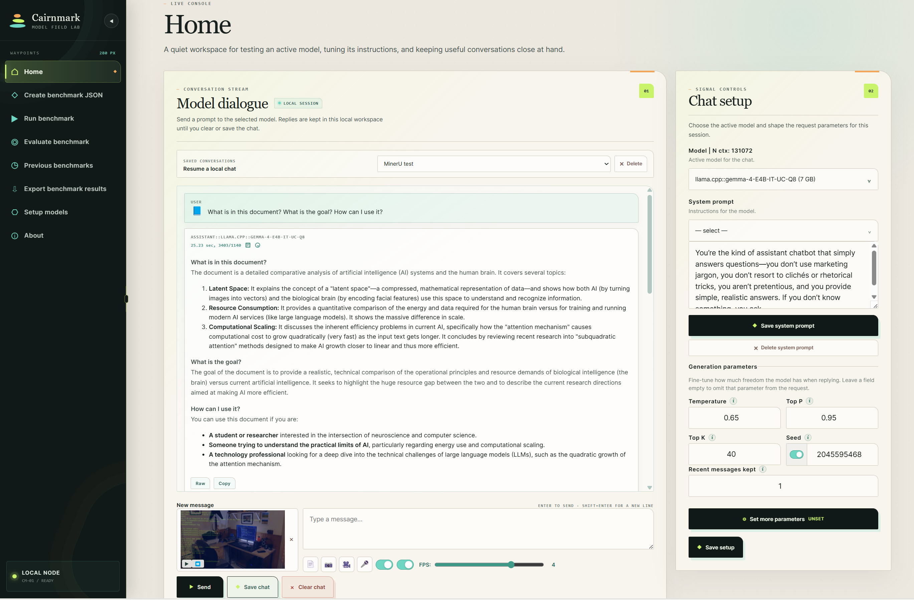
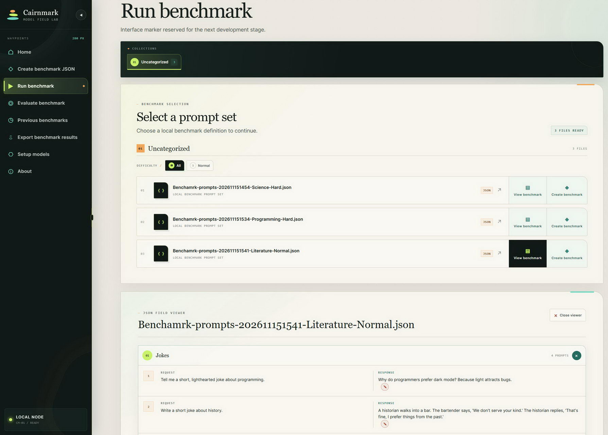
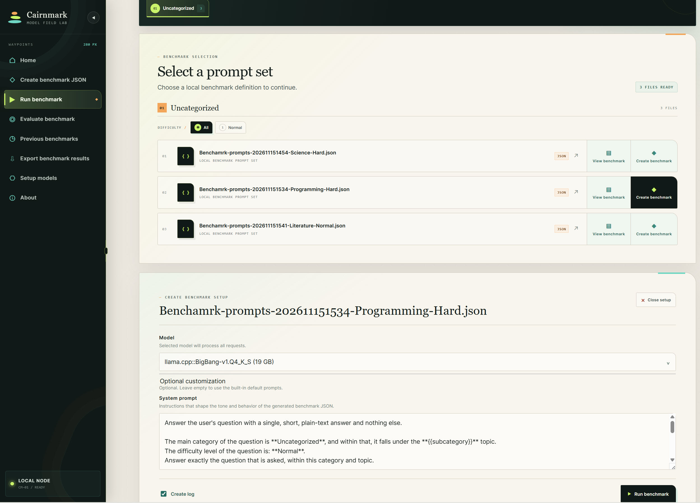

# CairnMark

> A private, local workspace for chatting with AI models 
> and creating, organizing, and running benchmark prompt sets. 

**Preview release · single user · localhost only** 
 
> Created by Primere Development [GitHub repository](https://github.com/CosmicLaca/Cairnmark)

---

## What CairnMark does

Cairnmark brings local and hosted model providers into one browser interface.
You can:

- chat with an enabled model, attach supported files, and save useful chats;
- generate benchmark JSON from topics and custom instructions;
- categorize, filter, inspect, and edit benchmark metadata;
- run benchmark requests sequentially against a selected model; and
- store answers, response times, and optional Markdown logs locally.

Benchmark files stay as readable JSON. Application settings and chat data use
local SQLite databases. Hosted-provider API keys are encrypted at rest.

**Preview limitation**

Evaluation, result history, and export are under development. Their pages
appear only in development mode and are not working product features.

## Quick navigation

| I want to… | Go to |
| --- | --- |
| Connect a model | [Set up a provider](#1-set-up-a-provider) |
| Test a model interactively | [Chat on Home](#2-chat-on-home) |
| Generate a benchmark file | [Create a benchmark](#3-create-a-benchmark) |
| Find or edit benchmark metadata | [Browse benchmark files](#4-browse-benchmark-files) |
| Run requests and record answers | [Run a benchmark](#5-run-a-benchmark) |
| Back up or move local data | [Data, privacy, and backups](#data-privacy-and-backups) |
| Fix a common problem | [Troubleshooting](#troubleshooting) |

## Install and start

### Requirements

- Python 3.14;
- Git, if you clone the repository;
- at least one local model server or hosted-provider API key; and
- FFmpeg on `PATH` for video/audio conversion. Cairnmark still starts without
  FFmpeg, but media conversion and audio extraction may be unavailable.

### Windows 11

```powershell
git clone https://github.com/CosmicLaca/Cairnmark.git
cd Cairnmark
python -m venv venv
.\venv\Scripts\activate
python -m pip install -r requirements.txt
.\run.bat
```

### Linux

```bash
git clone https://github.com/CosmicLaca/Cairnmark.git
cd Cairnmark
python3 -m venv venv
source venv/bin/activate
python -m pip install -r requirements.txt
./run.sh
```

Open [http://127.0.0.1:5000](http://127.0.0.1:5000). Keep the launcher terminal
open. Press **Ctrl+C** to stop Cairnmark.

To use another port:

```powershell
$env:PORT = "5050"
.\run.bat
```

```bash
PORT=5050 ./run.sh
```

> Cairnmark intentionally binds only to `127.0.0.1`. It is designed for one
> user on one computer, not as a network or hosted service.

## First session in five steps

1. Open **Setup models** and save a provider connection.
2. Enable the provider and, where shown, enable at least one model.
3. Open **Home** and send a test message.
4. Open **Create benchmark JSON** and generate a small benchmark.
5. Open **Run benchmark**, inspect the file, and run it against an enabled
   model.

## Interface overview

| Page | Purpose |
| --- | --- |
| **Home** | Chat, attachments, saved chats, system prompts, and generation settings |
| **Create benchmark JSON** | Generate benchmark JSON from topics and instructions |
| **Run benchmark** | Filter, inspect, organize, edit, and run benchmark files |
| **Setup models** | Configure providers and choose active models |
| **About** | Read this manual inside Cairnmark |

The sidebar can collapse to an icon rail. In expanded mode, drag its right edge
to resize it. With the resize handle focused, use the arrow keys, or
double-click the handle to restore its default width. The browser remembers the
layout.

---

## 1. Set up a provider

<p align="center"></p>

Cairnmark supports two local providers and ten hosted providers.

| Provider | Connection and model behavior |
| --- | --- |
| **llama.cpp** | Enter a local address and port; discovers and saves multiple models |
| **vLLM** | Enter a local address and port; reads its one loaded model live |
| **OpenRouter, OpenAI, Google Gemini, Anthropic, Mistral** | Enter an API key and fetch the provider catalog |
| **DeepSeek, OpenCode, OpenCode-ZEN, Z.ai, Grok** | Enter an API key and fetch the provider catalog |

### Connect and enable

1. Select a provider card on **Setup models**.
2. Enter the local endpoint or hosted API key.
3. Fetch the catalog and save the configuration.
4. Turn on the provider.
5. For providers with saved catalogs, turn on each model you want to use.

<p align="center"></p>

A model appears on other pages only when its provider and model are enabled.
An unreachable provider cannot remain enabled. vLLM is the exception: Cairnmark
queries its loaded model live, so vLLM has no separate saved model switch.

API keys are never returned to the browser after saving. They are encrypted in
`instance/cairnmark.db` with the key stored under `.secret/`.

---

## 2. Chat on Home

<p align="center"></p>

1. Choose an active model in **Chat setup**.
2. Optionally change the system prompt or generation controls.
3. Enter a message and select **Send**.
4. During generation, select **Abort** to request cancellation.

### Standard generation controls

The standard fields are system prompt, temperature, top p, top k, seed, min p, and
recent-message limit (labeled **Prev. messages**). **Save setup** stores only the selected model and these
standard fields as defaults for the next page load. The seed field has a
**Randomize seed** switch; when it is on, each send generates a new seed and
stores the switch state in `instance/cairnmark.db`. The **Prev. messages** field has a
**Send all previous messages** switch; when it is on, the input is disabled and all
previous messages are sent regardless of the input value. Its state is also stored
in `instance/cairnmark.db`.

A **Compact chat** button appears next to **Clear chat** when there is more than one message
or the estimated context usage is below 100%. It sends the previous request/response pairs
(selected by **Prev. messages**) to the model using prompts from `System-prompts/compress_system.md`
and `System-prompts/compress_user.md`, and stores the result as a compacted summary message.
That summary becomes the first message of future requests; previous messages stay visible but are
ignored. The button is disabled while a request is running, when there is no chat, when
**Prev. messages** is 0, or when context usage exceeds 100%.

The context-usage label below **Prev. messages** shows `used / max (percent%)`. Its background is
green up to 75%, orange up to 95%, and red above 95%, which also disables **Send**. A thin bar
above the message input mirrors the same percentage and colors. When no context size is known yet,
the label shows "getting context data…" and the bar is grey. For llama.cpp, the model label also
shows the detected context mode (`n_ctx`, `fit_on`, or `fit_off`) and the saved context size for
that mode.

The additional-parameters dialog is session-only:

- **Set** keeps its current inputs for later requests on the same page;
- **Unset** removes those inputs; and
- **Delete from local DB** removes cached defaults for a local model, so the
  next open reads and caches fresh values from the provider.
- **Save settings per model** stores the edited defaults for the selected model
  in `instance/parameters.db`, so they are reused on later opens.

Only allowlisted local sampling fields are forwarded to llama.cpp and vLLM.
Hosted providers ignore these additional local-model values.

### Attach files

The document button is always available. Image, video, and audio buttons appear
when the selected local model reports those capabilities.

| Attachment | Processing |
| --- | --- |
| Image | Images above 1.2 megapixels are resized before sending |
| Video | Re-encoded as MP4, scaled to a 480 px maximum side, converted at the selected FPS, and sent without audio by default |
| Audio | Converted to a 64 kbit/s MP3 when conversion is available |
| Document | Plain-text files are sent directly; supported binary formats are converted to Markdown through a configured MinerU service |

The maximum submitted attachment size is 100 MB, with up to eight attachments
per request.

- **Attach audio** extracts a video's audio and analyzes it in a separate model
  request when necessary.
- **Save the original attachment** saves the processed video/audio under
  `instance/preview/` so a player remains available in chat history.
- **FPS** appears after attaching a video. Use its slider to choose `0.1`,
  `0.25`, `0.5`, `1`, `2`, `4`, `8`, or `16` frames per second for both the
  video sent to the model and the processed video saved for preview. For
  example, `0.1` keeps one frame every 10 seconds, `0.25` keeps one every four
  seconds, and `2` keeps two frames per second. Lower values reduce the amount
  of video data sent but provide less temporal detail.

Both switches remember their last-used values in `instance/cairnmark.db`. Their
values remain selected after removing or sending an attachment and after
restarting Cairnmark. The FPS selection is saved to the same database only when
you click **Send**; moving the slider without sending does not overwrite the
saved value. The saved FPS is restored when the Home page is loaded and remains
the default for the next attached video.

### Documents and MinerU

The document button is always available. Plain-text files (`.txt`, `.md`,
`.json`, `.csv`, `.tsv`, `.html`, `.xml`, `.rtf`) are sent to the model as
text. Binary formats (PDF, images, Office documents, EPUB, and the other
MinerU-supported types) are converted to Markdown before sending when a MinerU
service is configured.

To use MinerU:

1. Right-click the document button, or click it when no endpoint is saved.
2. Enter the MinerU API endpoint (default `http://127.0.0.1:8100`) and an
   optional API key.
3. Select **Save**. Cairnmark checks the endpoint and stores it only when it
   responds.
4. Attach a supported binary document. Cairnmark shows "Document processing…"
   while MinerU converts it, then "thinking…" while the model replies.

The endpoint and API key are stored in `instance/cairnmark.db` and can be
changed later by right-clicking the document button. Unsupported file types are
rejected before upload.

Small image previews are stored in `instance/preview/`; chat history stores only
their randomized filenames.

### Save chat content

- **Save chat** creates or replaces a named conversation.
- **Saved chats** loads or deletes a stored conversation. Select a saved chat,
  continue the conversation, then choose **Replace chat** to overwrite that
  saved chat with the current conversation. A saved chat must be selected
  before it can be replaced.
- **Clear chat** clears the current conversation.
- Saved system prompts can be created, loaded, and deleted separately.

---

## 3. Create a benchmark

<p align="center"></p>

Open **Create benchmark JSON**, then configure:

1. **Category** — choose an existing category or create one.
2. **Difficulty** — choose Easy, Normal, or Hard.
3. **Model** — choose an enabled `provider::model` entry.
4. **Topics** — add topic names and request/response pair counts (1–100 per
   topic).
5. **Prompt customization** — optionally edit the system prompt and generation
   details.

Select **Create benchmark**. Cairnmark reports progress as the model completes
topics and pairs. On success it atomically saves the JSON, records metadata,
and displays the file on **Run benchmark**.

Generated filenames keep the application's historical spelling:

```text
Benchamrk-prompts-YYYYMMDDHHMM-Category-Difficulty.json
```

---

## 4. Browse benchmark files

<p align="center"></p>

Place imported `.json` files directly in `Benchmark-prompts/`, then reload
**Run benchmark**. Nested directories are not scanned.

Use category tabs and difficulty controls to filter cards. A file without saved
metadata appears under **Uncategorized** with **Normal** difficulty.

- Select the filename area to edit category, difficulty, notes, generation
  prompt, and source-model metadata.
- Select **View benchmark** to open the request/response accordion.
- Edit a reference response in the preview when it needs correction.
- Metadata changes do not move or rewrite the benchmark JSON file.

---

## 5. Run a benchmark

<p align="center"></p>

Select **Create benchmark** on a benchmark card to open the runner.

1. Choose an enabled model.
2. Review the prompt loaded from `System-prompts/run_benchmark-SYSTEM.md`.
3. Optionally enable **Create log**.
4. Select **Run benchmark** and keep the page open until processing finishes.

Cairnmark runs requests sequentially. It sends only each `request` and the
processed system prompt. It never sends the expected `response` or any other
benchmark key to the model.

Each result is appended to that request's `answers` array:

```json
{
  "model_name": "provider::model",
  "model_answer": "The model output",
  "response_time": 3
}
```

The source JSON is replaced atomically, and keys Cairnmark does not use are
preserved. Optional Markdown logs are written to `Benchmark-prompts/logs/`.

## Benchmark JSON format

The expected document is a top-level array of named topic objects. Each topic
contains a `benchmarks` array:

```json
[
  {
    "Networking": {
      "benchmarks": [
        {
          "request": "Which OSI layer provides end-to-end flow control?",
          "response": "The transport layer (Layer 4).",
          "answer_type": "short_text"
        }
      ]
    }
  }
]
```

Extra keys such as `answer_type` are allowed and remain intact when results are
saved.

---

## Data, privacy, and backups

| Location | Contents |
| --- | --- |
| `Benchmark-prompts/` | Benchmark JSON and appended run answers |
| `Benchmark-prompts/logs/` | Optional run logs |
| `System-prompts/` | Editable default prompt templates |
| `instance/cairnmark.db` | Benchmark metadata, providers, encrypted keys, chat defaults, and attachment preferences |
| `instance/chathistory.db` | Current chat, saved chats, and saved system prompts |
| `instance/parameters.db` | Cached local-model generation defaults |
| `instance/preview/` | Chat image and media previews |
| `.secret/` | Local API-key encryption key |

Content sent to hosted models is subject to that provider's terms and privacy
policy.

### Make a complete backup

1. Stop Cairnmark.
2. Copy `Benchmark-prompts/`, `System-prompts/`, `instance/`, and `.secret/`
   together.
3. Keep `instance/cairnmark.db` and `.secret/` paired; saved API keys cannot be
   decrypted without the matching key.

Do not publish these directories. They may contain prompts, model responses,
provider configuration, and credentials.

## Troubleshooting

### A model does not appear

Confirm that the configuration is saved, the provider is reachable and
enabled, and the model switch is enabled. For vLLM, confirm its server has one
model loaded.

### A benchmark file does not appear

Confirm that it:

- has a `.json` extension;
- is directly inside `Benchmark-prompts/`, not a nested folder; and
- contains valid JSON in the documented structure.

Reload the page after correcting the file.

### Video or audio conversion does not work

Install the FFmpeg executable and confirm `ffmpeg` is available on `PATH` from
the same terminal that starts Cairnmark. The Python package in
`requirements.txt` is a wrapper and does not install the FFmpeg executable.

### Port 5000 is already in use

Stop the earlier process or start Cairnmark with another `PORT`, as shown in
[Install and start](#install-and-start).

### Enable debug logging

```powershell
$env:CAIRNMARK_LOG_LEVEL = "DEBUG"
.\run.bat
```

```bash
CAIRNMARK_LOG_LEVEL=DEBUG ./run.sh
```

Provider keys and request content are not written to application logs.

## Developer reference

Show unfinished pages locally:

```powershell
.\venv\Scripts\python.exe app.py --dev
```

Run the isolated automated suite:

```powershell
.\venv\Scripts\python.exe -m pytest -q
```

```bash
venv/bin/python -m pytest -q
```

### Code map

| Area | Responsibility |
| --- | --- |
| `app.py` | Application factory and local launcher |
| `routes.py` | Declarative public URL mapping |
| `controllers/` | HTTP validation, responses, and page context |
| `services/` | Provider protocols and reusable business rules |
| `models/` | SQLite persistence boundary |
| `services/benchmark_documents.py` | Benchmark discovery and atomic file operations |
| `templates/` | Jinja page structure |
| `static/js/` | Browser behavior |
| `static/css/` | Shared shell and route-specific styling |

Tests use temporary databases, benchmark directories, and mocked provider
clients. They must not require live local or hosted model services.

## Roadmap

Planned but not currently available:

- evaluate recorded answers against reference responses;
- browse previous runs and scores; and
- export benchmark results.

Authentication, hosted multi-user deployment, and production service mode are
outside Cairnmark's current local, single-user scope.

---

## License

Copyright (c) 2026 Primere development. All rights reserved.