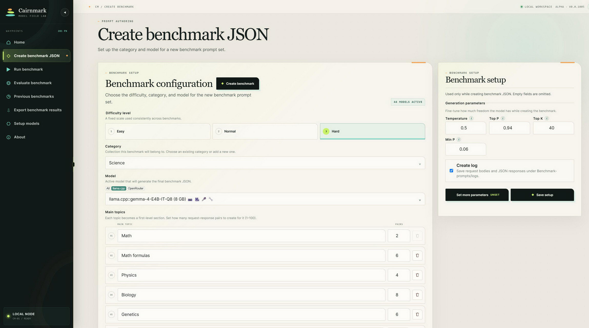
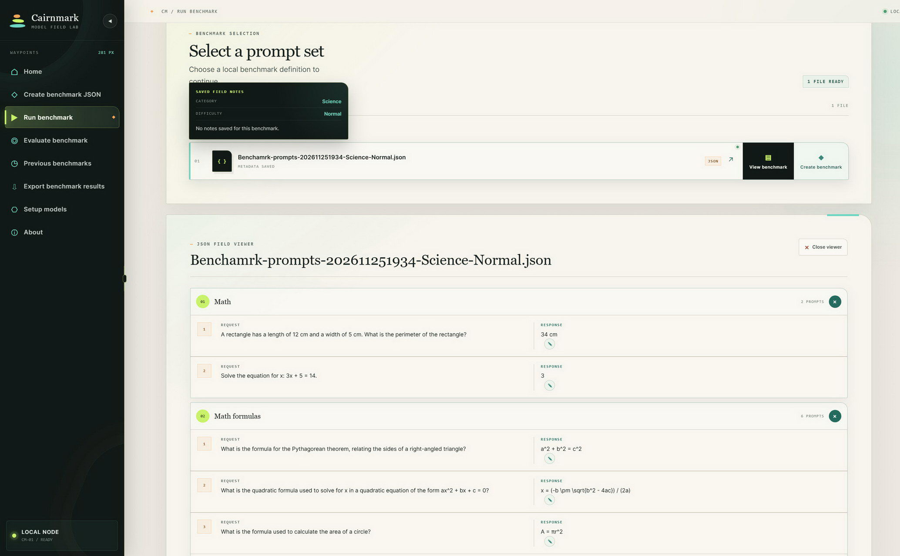
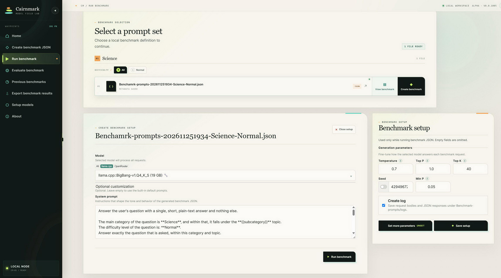

# Benchmark workflow

CairnMark stores benchmark prompt sets as user-owned JSON files. The workflow is
split into creation, organization, preview/editing, and execution.

## Create benchmark JSON

<!-- Screenshot placeholder: replace manual/create-benchmark.jpg when needed. -->

1. Choose an existing category or create a new one.
2. Select Easy, Normal, or Hard.
3. Choose an enabled model.
4. Add one or more topics and request-response pair counts.
5. Review the system and user prompt templates.
6. Adjust the page-specific **Benchmark setup** sidebar if needed.
7. Generate the file.

Generation progress follows topics as the model streams JSON. CairnMark extracts
the first valid JSON value, writes it atomically to `Benchmark-prompts/`, and
saves category, difficulty, generation prompt, and model metadata in
`instance/cairnmark.db`.

The default prompt templates are:

- `System-prompts/create_benchmark-SYSTEM.md`; and
- `System-prompts/create_benchmark-USER.md`.

### Benchmark creation settings

The right-hand **Benchmark setup** sidebar controls only benchmark JSON
creation. Its **Generation parameters** include Temperature, Top P, Top K,
Seed, and Min P. The randomize switch beside Seed decides whether CairnMark
uses the entered seed or generates one for the request.

Use **Save setup** to store these values and the **Create log** choice in the
local database. They are restored when the Create benchmark page is opened
again and do not change the Chat or Run benchmark settings. The selected model
is also remembered when **Create benchmark** is clicked and is restored when a
saved selection is available.

**Set more parameters** opens the Additional model parameters dialog. Click
**Set** to include its current parameters in creation requests. Click **Unset**
to exclude all additional parameters; the main values in the sidebar continue
to be used.

When **Create log** is enabled, CairnMark records the request bodies and raw
JSON responses for the complete creation process under
`Benchmark-prompts/logs/`. Log data is grouped by the benchmark's main topic.

Every generation step is an independent model request. CairnMark sends only the
special benchmark system prompt and the current user prompt with its
placeholders filled. It does not send conversation history, and never call tools.

## Browse and edit files

<!-- Screenshot placeholder: replace manual/view-benchmark.jpg when needed. -->

The Run benchmark page discovers `.json` files directly inside
`Benchmark-prompts/`. Categories and difficulty filters come from saved
metadata. A preview shows topics, requests, expected responses, and recorded
answers without executing a model.

Select a file to edit its category, difficulty, notes, generation prompt, and
model name. Creating a category before any benchmark uses it stores that name in
the database; category matching is case-insensitive.

## Run a benchmark

<!-- Screenshot placeholder: replace manual/run-benchmark.jpg when needed. -->

1. Select a benchmark file and click **Create benchmark** to open its setup.
2. Choose an enabled model in the left **Create benchmark setup** panel.
3. Review the system prompt.
4. Adjust the independent **Benchmark setup** sidebar on the right.
5. Optionally enable logging.
6. Click **Run benchmark**.

The two setup areas are separate panels. **Create benchmark setup** contains
the selected file's model and prompt controls. The right-hand **Benchmark
setup** contains the run-only Generation parameters, logging option, and setup
actions.

### Benchmark run settings

The Run benchmark sidebar provides Temperature, Top P, Top K, Seed, and Min P,
including the randomize-seed switch. Use **Save setup** to store these values
and the **Create log** choice in the local database. CairnMark restores them on
the next visit to the Run benchmark page. These settings are separate from
both Chat and Create benchmark settings.

Use **Set more parameters** when the selected model needs additional supported
parameters. **Set** includes the dialog values in benchmark requests, while
**Unset** removes them and leaves only the main sidebar parameters active.

Each request sends only its `request` value to the model. The expected
`response`, evaluation fields, and every other JSON key stay local. CairnMark
records the model answer and response time in that request's `answers` array.

The file is replaced atomically in its original directory. Unknown keys such as
`answer_type` are preserved. Optional logs are written to
`Benchmark-prompts/logs/`.

## File expectations

- Files must use the `.json` extension.
- Files must be directly inside `Benchmark-prompts/`.
- The JSON must use supported nested topic/request structures.
- The browser treats file content and model output as untrusted text.

If a file is missing, validate its extension and JSON syntax, then reload the
page. CairnMark never scans arbitrary directories for benchmark data.

## Current limits

Automated evaluation, benchmark result history, result export, and accounts are
not working features in the preview. The evaluation page remains development
only and should not be treated as a completed workflow.
