# Chat workspace

---

The Home page combines model selection, reusable system prompts, generation
controls, attachments, context management, saved conversations, and optional
MCP tools.

<!-- Screenshot placeholder: replace manual/homepage.jpg when the chat UI changes. -->
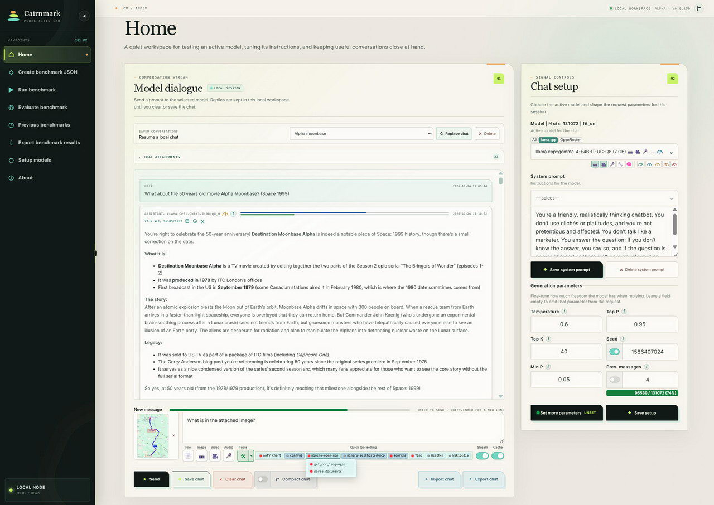

---

## Start a conversation

1. Enable providers and models on **[Setup models](model-setup.md)**
2. Select it under **Active model for the chat**.
3. Enter an optional system prompt and generation settings.
4. Type a message and select **Send**.

The assistant bubble records provider, model, response time, token counts, and
the request body used for debugging. The small **Use this model** action on an
assistant bubble selects that response's model again if it is still available.

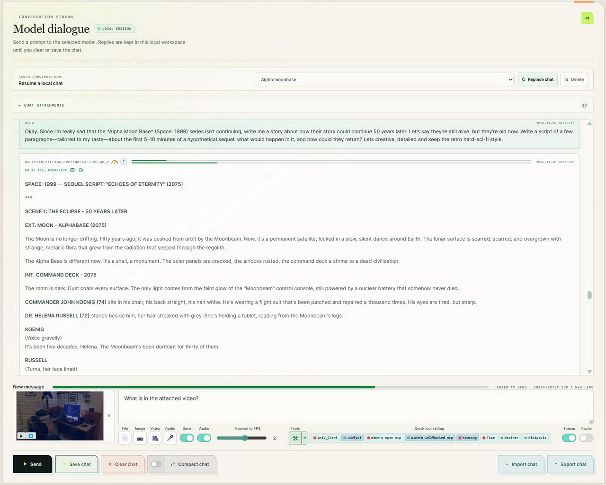

### Filter the model list

The provider buttons above the model selector limit the list to one provider at
a time. The icon row below the selector provides additional filters for image,
video, audio, tool, and reasoning support, followed by the five relative-speed
categories. An active icon has a green background; select it again to remove
that filter.

Capability filters use **AND** logic. For example, selecting image and
reasoning support shows only models that support both. Speed filters use
**OR** logic, so selecting the two fastest speedometers shows models in either
speed category. Selecting no speedometers—or all five—turns off speed
filtering. Provider, capability, speed, and model-name search filters work
together, and an empty result is allowed.

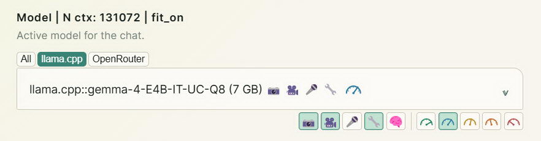

---

## Response metadata and failed requests

A failed model request creates an assistant bubble instead of leaving an
unanswered user message. The bubble contains the error and retains the same
diagnostic context as a successful response, including provider, model, system
prompt, request body, and time. Its red error appearance is stored with the
message and survives page reloads, saved-chat loading, replacement, export, and
import.

When a response actually used one or more MCP tools, a tool icon appears next
to **Show API request body**. Hover over it to see the distinct tools in
`provider::tool` form. The marker records tools that were called, not merely
tools that were available, and is preserved with the conversation.

### Per-response meters

Two thin meter lines appear in the header of each completed assistant bubble:

- The upper line compares that response's combined input and output tokens with
  the model-specific maximum context size that was active for the request. It
  measures only the displayed request-response result, not the accumulated
  conversation-context estimate above the message composer.
- The lower line compares the response time with a 300-second reference. A full
  line therefore represents five minutes.

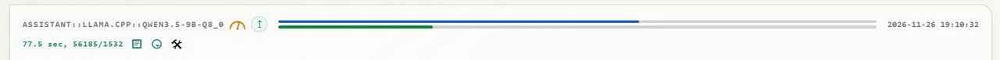

Both meters progress from green through blue and orange to red as their
percentage increases. Hover over a line to see its exact percentage and source
values. If CairnMark has no saved `n_ctx` value for the model's current local
start mode, the context line remains grey. Use **Set more parameters** to read
and cache the model parameters when that information is available.

### Relative model speedometer

After a model completes at least one successful response with reported output
tokens, a small speedometer appears beside its name in assistant bubbles and in
all model-selection dropdowns. Hover over it to see the model's cumulative
average generation speed in tokens per second.

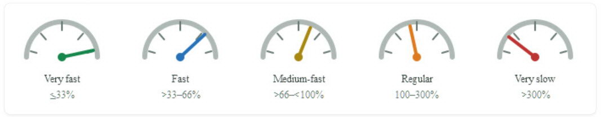

CairnMark calculates each model's speed as cumulative output tokens divided by
cumulative response time. It then compares that value with the weighted global
average across all measured models, where the global average equals 100%.
Higher percentages indicate faster generation:

- 300% or more: very fast;
- 150% to below 300%: fast;
- above 100% to below 150%: moderately fast;
- one third of the global average through 100%: regular; and
- below one third of the global average: very slow.

Only completed responses with a positive reported output-token count contribute
to the measurement. Failed requests and providers that do not report output
usage are ignored. Early ratings can change noticeably because every new
successful response updates both the model average and the global baseline.

---

## Saved setup

**Save setup** stores one initial-form row in `instance/cairnmark.db`:

- selected model;
- system prompt;
- temperature, top p, top k, min p, and seed; and
- recent-message limit.


The additional parameter modal is not part of this saved setup. Local model
defaults are cached separately per model.

---

# Controls

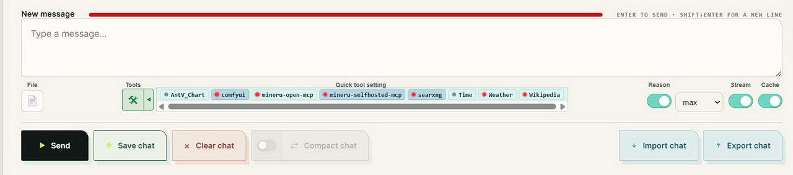

## Streaming and cancellation

Enable **Stream responses** to render incoming Markdown while generation is in
progress. With streaming off, the loading bubble reports character progress
until the complete answer arrives. The switch is saved when a request is sent.

**Abort** asks the active request to stop and removes an unanswered final user
message. Completed assistant messages remain in history.

---

## Reasoning controls

For a llama.cpp model whose saved chat-template capabilities report reasoning
effort support, a **Reasoning** switch appears beside **Stream responses**.
Turning it on displays the effort levels advertised by that model, such as
**low**, **medium**, or **xhigh**. CairnMark sends the selected effort with
thinking enabled for the request.

With the switch off, CairnMark requests `reasoning_effort: none` and disables
template thinking. The switch is intentionally not saved and always starts off
after the page is loaded. Models without saved reasoning support do not show
either control and receive no reasoning-specific request settings.

Reasoning effort controls hidden model reasoning, not the length of the visible
answer. Use a maximum-token parameter when a strict response limit is required.

---

## Conversation context

The context meter estimates selected input and output tokens against the active
model's saved context size. **Prev. messages** keeps complete recent user and
assistant pairs. **Send all previous** ignores that numeric limit.

Manual **Compact** uses the templates in `System-prompts/compress_system.md` and
`System-prompts/compress_user.md`. The compacted assistant summary becomes the
new history boundary. Automatic compaction can trigger at the configured
percentage when the model's context size is known.

Compaction is model-generated summarization, not lossless archiving. Save or
export important conversations before compacting them.

---

## Attachments

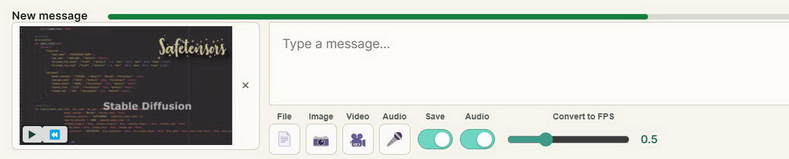

CairnMark accepts supported images, documents, audio, and video from the chat
composer. Attachment data is treated as untrusted input and validated before it
is sent to a provider.

- Images are resized for model requests and can retain a local preview.
- Video is converted at the selected FPS; optional audio analysis becomes a
  second request when needed.
- Audio is converted to a provider-compatible format.
- Documents can be sent as extracted text. MinerU can process supported binary
  documents when its local endpoint is configured.
- FFmpeg must be available on `PATH` for video and audio conversion.

---
### Image attachment:


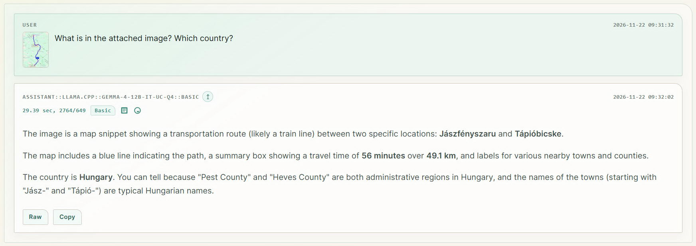

---
### Video attachment:


---
### Audio attachment:

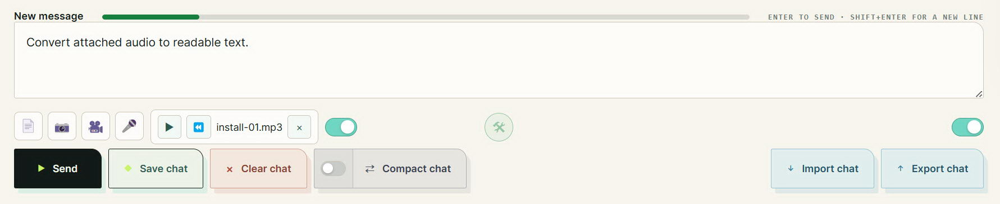
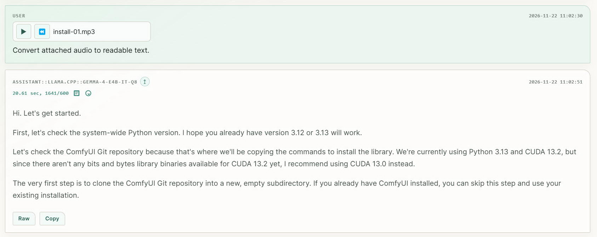

---

The media preference switches are saved independently. Cancelling a parameter
modal removes its temporary fields from the following request; saving the modal
keeps them in the page until it is reloaded.

---

## Chat attachments accordion

When the current conversation contains related files or links, the collapsed
**Chat attachments** row appears above the conversation. Open it to browse a
height-limited, scrollable list grouped under **Images**, **Audios**,
**Videos**, **Documents**, and **External links**. Local items show their
filename and a download action. Hovering an available image filename displays
a floating preview. If a referenced local file was moved or deleted, its name
remains visible with a **Missing** notice instead of a download action.

Uploaded files and documents created by MCP tools are registered in
`instance/media.db` as soon as they become associated with the active chat.
The accordion reads this index directly instead of parsing the complete
conversation, which keeps saved-chat loading fast. Saving, loading, replacing,
importing, or deleting a chat updates its media references as part of the same
chat action.

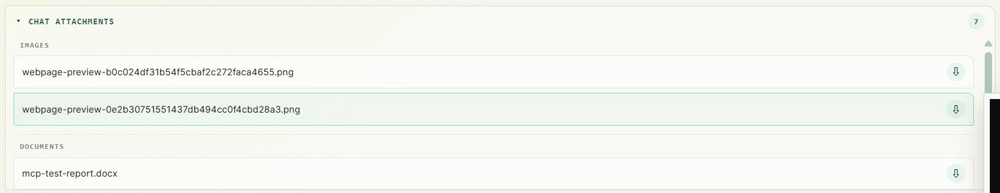

Files under `instance/preview/` are reference-aware. Deleting or clearing a
chat removes a preview file only when no active or saved chat still references
it. MCP-created files under `Generated-documents/` are never deleted with a
chat; the user remains responsible for managing that folder.

---

## Generated document downloads and previews

When an MCP tool creates a recognized file under `Generated-documents/`, its
assistant response displays a document card with the filename and download
action. The card remains associated with the response after a browser reload,
saved-chat loading, export, and import. In an assistant bubble, all response
content and document cards appear above a separator; the **Raw** and **Copy**
actions remain below that line.

Hover over a supported document card to open a floating preview. Generated
documents listed under **Documents** in the **Chat attachments** accordion use
the same preview. The panel can grow to 480 pixels wide and 600 pixels high,
subject to the available browser viewport. Move the pointer from the filename
into the panel to keep it open and scroll the document. The preview closes
automatically after the pointer leaves both the filename and preview area, so
only one document preview can remain open.

PDF previews use the original file directly from `Generated-documents/`; no
duplicate PDF is created. Browsers cannot display DOCX or ODT files directly,
so CairnMark creates a safe, lightweight HTML representation containing their
readable headings, text formatting, lists, and tables. Text, Markdown, JSON,
and CSV files use the same HTML preview path. These generated previews are
stored under `instance/document-previews/` with an added `.html` suffix, for
example:

```text
Generated-documents/renewable-report.docx
instance/document-previews/renewable-report.docx.html
```

The cached preview is reused until the source document changes or CairnMark's
preview format is updated. Preview generation uses Python's standard library
and does not start LibreOffice or call the MCP service that created the file.
The HTML view is intended for quick reading; download the original document to
inspect exact pagination, embedded media, advanced styles, or unsupported
legacy formats such as `.doc`.

---

## Images, audio, and video in answers

Direct public image URLs can appear as previews while retaining the original
link. CairnMark validates redirects, rejects private-network targets, and limits
downloads to 25 MB. Sites requiring login, CAPTCHA, hotlink permission, or an
expiring token remain ordinary links.

Direct audio URLs can become compact players. Supported YouTube and Vimeo watch
URLs become lazy-loaded video players. Search pages and unsupported hosts remain
links; CairnMark does not invent a media stream that a tool did not return.

Uploaded image previews offer Google Lens, TinEye, and Yandex reverse-search
shortcuts. A local upload cannot be submitted to another site automatically,
so CairnMark opens the provider's official upload page and leaves sending the
image as an explicit user action.

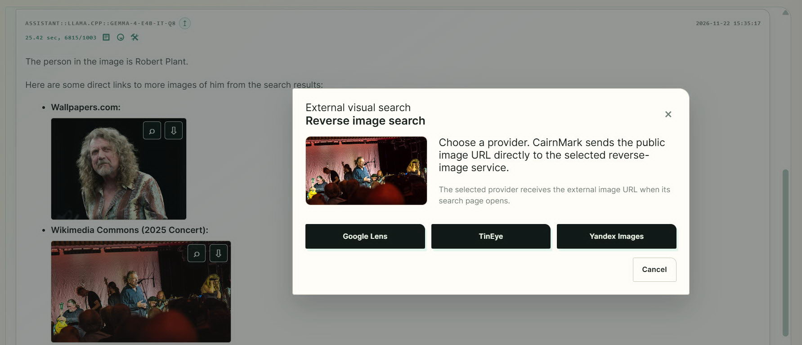

Public external images rendered in an assistant response have the same search
action next to their download control. In this case CairnMark supplies the
public image URL to the selected reverse-search provider automatically. This is
available only for successfully loaded external images; inaccessible images
remain ordinary links.

---

## Webpage link screenshots

Ordinary public HTTP or HTTPS page links in an assistant response can display a
320-pixel-high screenshot when hovered. Image, audio, and video URLs continue to
use their specialized previews. CairnMark captures at most five distinct pages
per response, follows only safe public destinations, and ignores a page when it
does not return HTTP 200 or cannot be captured within the configured timeout.

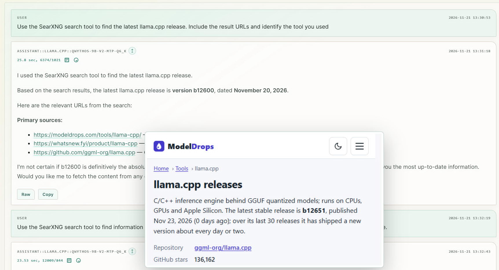

Preview images use generated identifiers under `instance/preview/`; the remote
URL is never used as a filename. The URL-to-preview mapping is message metadata,
so screenshots remain associated with the correct link after reload, saved-chat
loading, export, and import.

Right-click the chat tool icon to turn **Capture webpage preview** on or off and
set its timeout from 1 to 30 seconds. The defaults are enabled and 2 seconds.
See **[Global tool status and execution policy](mcp-tools.md#global-tool-status-and-execution-policy)**
for the other controls in that dialog.

---

## Save, replace, import, and export chats

- **Save chat** stores a named copy in `instance/chathistory.db`.
- **Load** replaces the active conversation with the selected saved chat.
- **Replace** overwrites that selected saved chat with the current conversation.
- **Delete** removes the selected saved chat and clears its active copy.
- **Export** writes an import-ready JSON document to `Exported-chat/`.
- **Import** validates an exported document before replacing active history.

To explore a ready-made example on a new installation, select **Import** and
open `Exported-chat/Exported-Alpha_moonbase-2026-11-26_20-48-35.json`. The
included Alpha moonbase conversation demonstrates the imported chat format and
can be inspected without first creating a conversation.


Preview files are removed only when neither active history nor another saved
chat references them.

---

## MCP tools

The tool button appears only for a model whose saved capability data reports
tool-call support. See **[MCP tool handling](mcp-tools.md)** for switches, service
status, global policy, response markers, caching, and execution behavior. The
complete local SearXNG procedure is in **[tool-setup.md](tool-setup.md)**.
App-level Weather, Stock, AntV Chart, and LibreOffice examples are documented in
**[mcp-tools-examples.md](mcp-tools-examples.md)**.


---

## Troubleshooting

### The context meter has no maximum

Open the local model's parameter modal once so CairnMark can cache its context
size. Hosted models may not expose an equivalent local `/props` value.

### Media conversion fails

Confirm that `ffmpeg` is available in the same terminal environment used to
start CairnMark. Retry with a smaller file and a lower video FPS.

### Imported chat is rejected

Import a JSON export produced by CairnMark. Invalid roles, message shapes, or
unsafe oversized values are rejected without clearing the current conversation.
