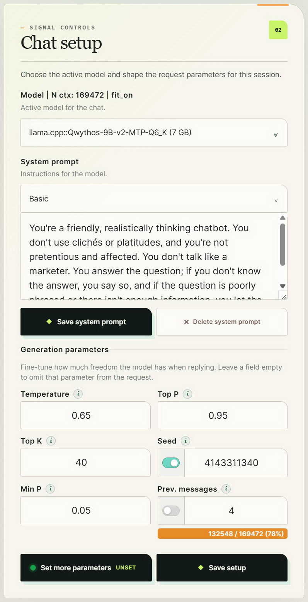
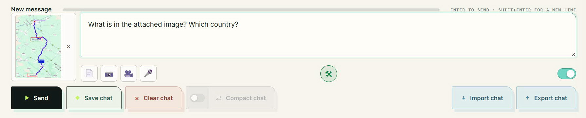
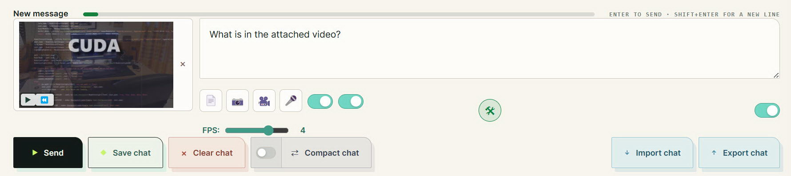
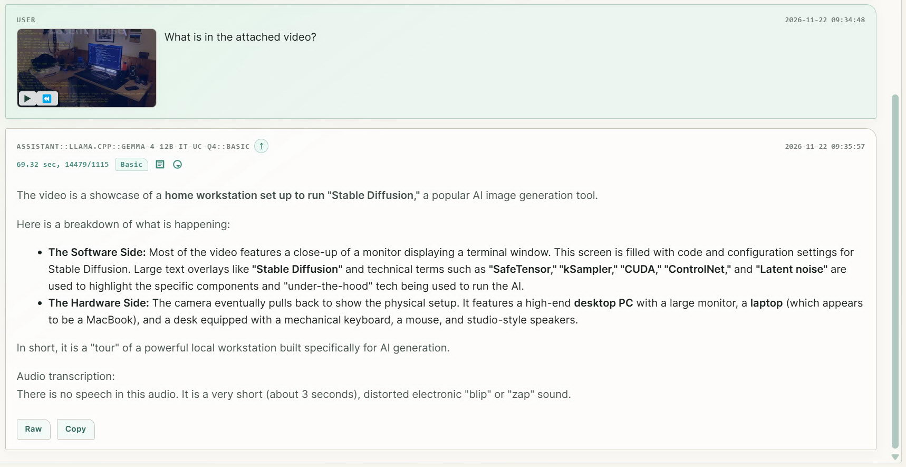
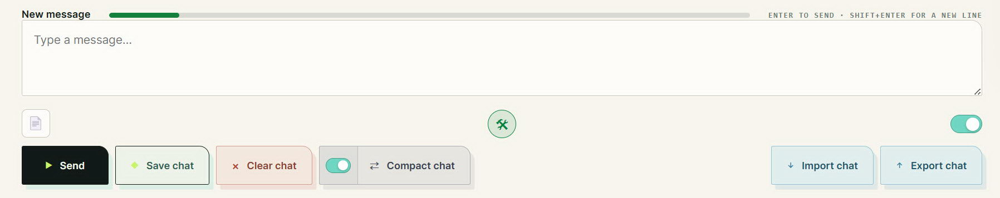
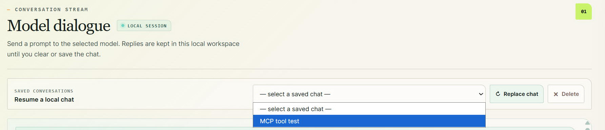
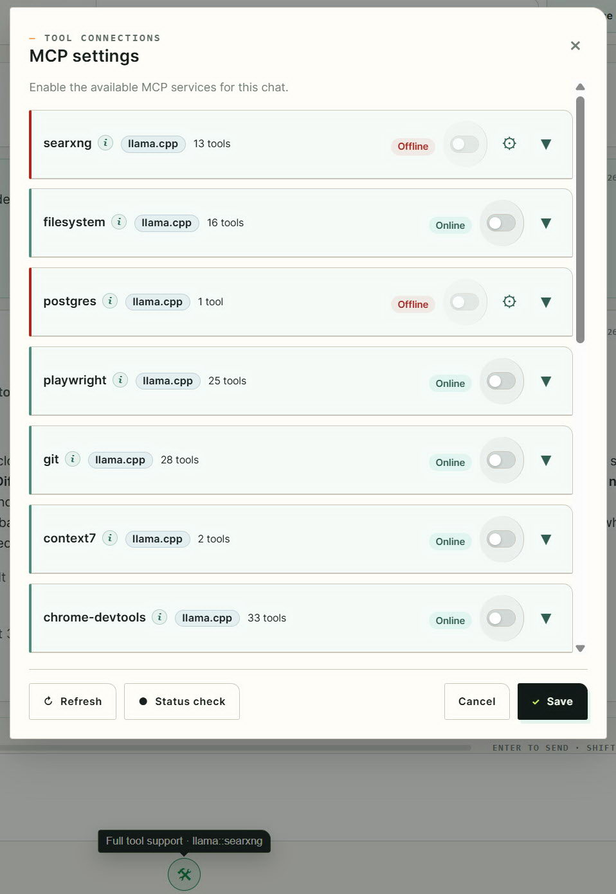

# Chat workspace

---

The Home page combines model selection, reusable system prompts, generation
controls, attachments, context management, saved conversations, and optional
MCP tools.

<!-- Screenshot placeholder: replace manual/homepage.jpg when the chat UI changes. -->

---

## Start a conversation

1. Enable providers and models on **[Setup models](model-setup.md)**
2. Select it under **Active model for the chat**.
3. Enter an optional system prompt and generation settings.
4. Type a message and select **Send**.

The assistant bubble records provider, model, response time, token counts, and
the request body used for debugging. The small **Use this model** action on an
assistant bubble selects that response's model again if it is still available.

---

## Saved setup

**Save setup** stores one initial-form row in `instance/cairnmark.db`:

- selected model;
- system prompt;
- temperature, top p, top k, min p, and seed; and
- recent-message limit.

The additional parameter modal is not part of this saved setup. Local model
defaults are cached separately per model.

---

## Streaming and cancellation

Enable **Stream responses** to render incoming Markdown while generation is in
progress. With streaming off, the loading bubble reports character progress
until the complete answer arrives. The switch is saved when a request is sent.

**Abort** asks the active request to stop and removes an unanswered final user
message. Completed assistant messages remain in history.

---

## Conversation context

The context meter estimates selected input and output tokens against the active
model's saved context size. **Prev. messages** keeps complete recent user and
assistant pairs. **Send all previous** ignores that numeric limit.

Manual **Compact** uses the templates in `System-prompts/compress_system.md` and
`System-prompts/compress_user.md`. The compacted assistant summary becomes the
new history boundary. Automatic compaction can trigger at the configured
percentage when the model's context size is known.

Compaction is model-generated summarization, not lossless archiving. Save or
export important conversations before compacting them.

---

## Attachments

CairnMark accepts supported images, documents, audio, and video from the chat
composer. Attachment data is treated as untrusted input and validated before it
is sent to a provider.

- Images are resized for model requests and can retain a local preview.
- Video is converted at the selected FPS; optional audio analysis becomes a
  second request when needed.
- Audio is converted to a provider-compatible format.
- Documents can be sent as extracted text. MinerU can process supported binary
  documents when its local endpoint is configured.
- FFmpeg must be available on `PATH` for video and audio conversion.

---
### Image attachment:

---
### Video attachment:

---

The media preference switches are saved independently. Cancelling a parameter
modal removes its temporary fields from the following request; saving the modal
keeps them in the page until it is reloaded.

---

## Images, audio, and video in answers

Direct public image URLs can appear as previews while retaining the original
link. CairnMark validates redirects, rejects private-network targets, and limits
downloads to 25 MB. Sites requiring login, CAPTCHA, hotlink permission, or an
expiring token remain ordinary links.

Direct audio URLs can become compact players. Supported YouTube and Vimeo watch
URLs become lazy-loaded video players. Search pages and unsupported hosts remain
links; CairnMark does not invent a media stream that a tool did not return.

Uploaded image previews offer Google Lens, TinEye, and Yandex reverse-search
shortcuts. CairnMark saves a local JPEG and opens the provider's official upload
page; sending the image remains an explicit user action.

---

## Save, replace, import, and export chats

- **Save chat** stores a named copy in `instance/chathistory.db`.
- **Load** replaces the active conversation with the selected saved chat.
- **Replace** overwrites that selected saved chat with the current conversation.
- **Delete** removes the selected saved chat and clears its active copy.
- **Export** writes an import-ready JSON document to `Exported-chat/`.
- **Import** validates an exported document before replacing active history.

Preview files are removed only when neither active history nor another saved
chat references them.

---

## MCP tools

The tool button appears only for a model whose saved capability data reports
tool-call support. See **[MCP tool handling](mcp-tools.md)** for switches, service
status, caching, and execution behavior. The complete local SearXNG procedure is
in **[tool-setup.md](tool-setup.md)**.

---

## Troubleshooting

### The context meter has no maximum

Open the local model's parameter modal once so CairnMark can cache its context
size. Hosted models may not expose an equivalent local `/props` value.

### Media conversion fails

Confirm that `ffmpeg` is available in the same terminal environment used to
start CairnMark. Retry with a smaller file and a lower video FPS.

### Imported chat is rejected

Import a JSON export produced by CairnMark. Invalid roles, message shapes, or
unsafe oversized values are rejected without clearing the current conversation.
