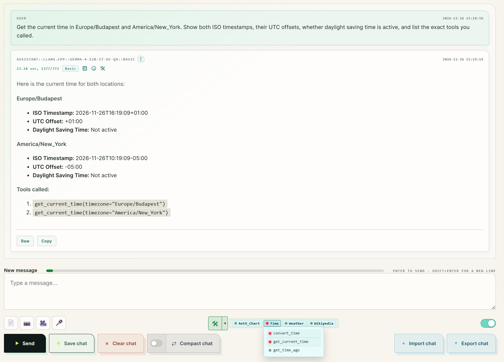
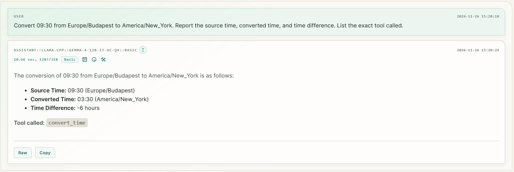
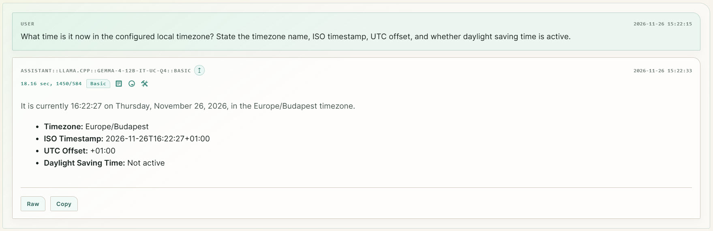

# Custom MCP tool example: Time

This guide installs and configures the official
[Time MCP Server](https://github.com/modelcontextprotocol/servers/tree/main/src/time)
directly in CairnMark. It provides the current time in an IANA timezone and
converts a time between two IANA timezones. It requires no API key or external
account, and its two-tool interface has a small prompt cost.

This is a **Custom** CairnMark service. The instructions do not add it to
OpenCode or llama.cpp. Its setup schema is committed to the repository, but
the uv cache, private `services/mcp.json`, and `instance/tools.db` records are
local data and must be recreated after a fresh clone.

---

## 1. Prepare CairnMark

Complete the normal CairnMark installation first. Open PowerShell in the
repository root and keep the absolute project path for the commands below:

```powershell
Set-Location "C:\path\to\CairnMark"
$ProjectRoot = (Get-Location).Path
```

Open **Home**, select the tool icon below the chat input, and use **Add new
custom MCP service**. After the service is accepted:

1. enable its Custom parent switch;
2. expand it and enable `get_current_time` and `convert_time`;
3. select **Save** in MCP settings; and
4. right-click the tool icon, enable global tool use, and save.

Always use an absolute executable path and a valid JSON array in **Args**.

---

## 2. Install Python and uv

The Time server uses Python and the `uvx` runner supplied by uv. Check the
current installations:

```powershell
py --version
uv --version
uvx --version
```

If uv or uvx is missing, install uv with Windows Package Manager:

```powershell
winget install --id=astral-sh.uv -e
```

Close and reopen PowerShell after installation, return to the repository root,
and recreate `$ProjectRoot`. Then locate the absolute runner path:

```powershell
$Uvx = (Get-Command uvx).Source
$Uvx
```

---

## 3. Prepare the application-local Time server

Create the local package cache under `mcp_tools/time` and pre-download the
server:

```powershell
$TimeCache = Join-Path $ProjectRoot "mcp_tools\time\cache"
New-Item -ItemType Directory -Path $TimeCache -Force | Out-Null

& $Uvx --isolated --cache-dir $TimeCache "mcp-server-time" --local-timezone=Europe/Budapest
```

The last command starts the stdio MCP server and waits for a client. After the
download finishes and the server starts, press `Ctrl+C`. This is expected and
does not remove the cached installation.

Print the exact one-line JSON value required by CairnMark's **Args** field:

```powershell
ConvertTo-Json -InputObject @(
    "--offline",
    "--isolated",
    "--cache-dir",
    $TimeCache,
    "mcp-server-time"
) -Compress
```

Copy the complete output line, including the opening and closing square
brackets. Do not enter `$TimeArgs`, `$TimeCache`, or any other PowerShell
variable name in CairnMark. The form accepts only a JSON array of strings.

For example, if CairnMark is installed at
`E:\!Works\AI\!Applications\ClairnMark`, paste this into **Args**:

```json
["--offline","--isolated","--cache-dir","E:/!Works/AI/!Applications/ClairnMark/mcp_tools/time/cache","mcp-server-time"]
```

Forward slashes are intentional in the example and avoid JSON escaping for
Windows backslashes. The generated PowerShell output may instead contain
escaped backslashes; that output is also valid JSON.

No command in this guide installs the server into CairnMark's main virtual
environment. The package and its environment remain in `mcp_tools/time/cache`.

---

## 4. Add the Custom service

Use these values:

| Field | Value |
| --- | --- |
| Name | `Time` |
| Timeout (ms) | `30000` |
| Command | Value printed as `$Uvx` |
| Args | Complete one-line JSON printed by the command in section 3 |

Leave endpoint, username, and password empty. The `--offline` argument makes
normal CairnMark launches use the application-local cache instead of checking
PyPI each time.

Do not add `--local-timezone` to **Args**. After entering the name `Time`, use
the **Local IANA timezone** dropdown that appears below the connection fields.

The committed `static/tool-setup-time.json` schema provides the **Local IANA
timezone** setting and defaults it to `Europe/Budapest`. CairnMark appends the
saved option and value when starting the server, equivalent to
`--local-timezone=Europe/Budapest`.
Use an IANA timezone name such as `Europe/Budapest`, `America/New_York`, or
`Asia/Tokyo`, not an abbreviation such as `CET` or `EST`.

The local timezone defines what an unqualified “now” means. Requests may still
ask `get_current_time` for any valid IANA timezone.

---

## 5. Test prompts

Current-time test:

> Get the current time in `Europe/Budapest` and `America/New_York`. Show both ISO timestamps,
> their UTC offsets, whether daylight saving time is active, and list the exact
> tools you called.
> 
> 

Conversion test:

> Convert 09:30 from `Europe/Budapest` to `America/New_York`. Report the source time, converted time, and time
> difference. List the exact tool called.
> 
> 

Local-timezone test:

> What time is it now in the configured local
> timezone? State the timezone name, ISO timestamp, UTC offset, and whether
> daylight saving time is active.
> 
> 

Change **Local IANA timezone** to `America/New_York`, save the service, and run
the local-timezone test again. The returned local timezone should change
without editing the base **Args** field.

---

## 6. Troubleshooting

- `spawn ... ENOENT` usually means **Command** is not the absolute path printed
  as `$Uvx`.
- **Args must be a JSON array of strings** means the field contains a
  PowerShell variable, command, plain path, or malformed JSON. Paste the full
  one-line array printed in section 3. Every item must use double quotes.
- An offline uv error means the cache is incomplete. Remove `--offline`
  temporarily, start the service once successfully, then restore it. The
  temporary online **Args** value begins with `"--isolated"` instead.
- A timezone error usually means the setup value is not a valid IANA timezone
  name. Use names such as `Europe/Budapest`, not display names or abbreviations.
- Timezone offsets can change with daylight-saving rules. Use the tool result
  instead of assuming a fixed difference between two locations.

---

## 7. Updating or removing the local installation

Refresh the cache by rerunning the online command with `--refresh`, then press
`Ctrl+C` after startup:

```powershell
& $Uvx --refresh --isolated --cache-dir $TimeCache "mcp-server-time" --local-timezone=Europe/Budapest
```

After an update, open MCP settings and select **Refresh**. Review the tool list
before enabling newly added or renamed tools.

Commit the reusable integration files:

- `static/tool-setup-time.json`;
- this manual page; and
- its README links.

Do not commit the recreated runtime data:

| Location | Reason |
| --- | --- |
| `mcp_tools/time/cache/` | Downloaded uv packages and environments |
| `services/mcp.json` | Machine-specific absolute commands and arguments |
| `instance/tools.db` | Local switches, cached definitions, and settings |

For global switches, execution limits, service status, refresh behavior, and
general troubleshooting, return to **[MCP tool handling](./mcp-tools.md)**.
The Wikipedia and Yahoo Finance examples remain in
**[Custom MCP tool examples 2](./mcp-tools-examples-2.md)**.
