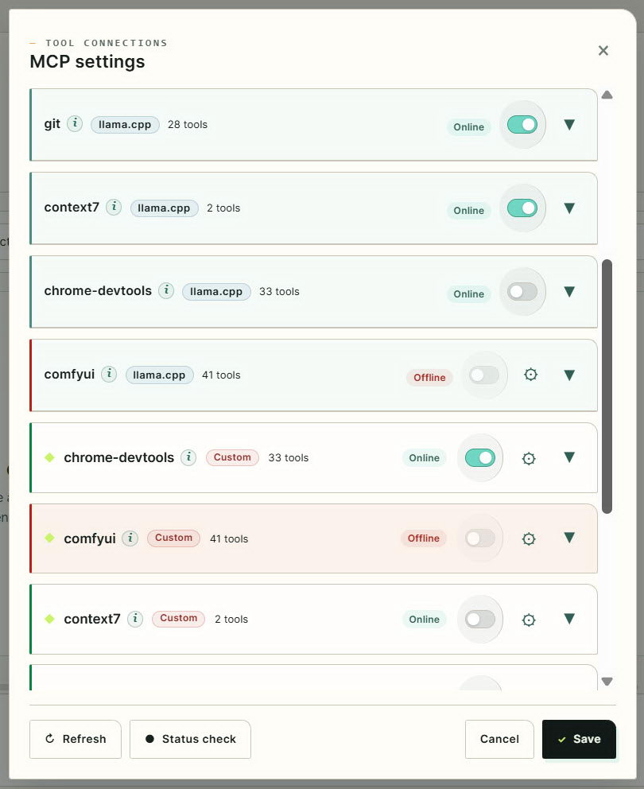

# MCP tool handling

CairnMark can expose enabled MCP tools to compatible chat models. Tool access is
off on first run and is controlled at three levels: the global switch, the main
service switch, and individual subtool switches.

<!-- Screenshot placeholder: add manual/mcp-settings.jpg after capturing the MCP settings modal. -->

---

| Main tool setup                                                                                  | Tool setup                                                                                | Endpoint setting                                                                          |
|--------------------------------------------------------------------------------------------------|-------------------------------------------------------------------------------------------|-------------------------------------------------------------------------------------------|
| 

 | 

 | 

 |
 
---

## Connection sources

| Source | Ownership | Discovery |
| --- | --- | --- |
| llama.cpp | The active llama.cpp server | The server must start with its own MCP configuration |
| Custom | CairnMark | Declarations live in `services/mcv.json` and use stdio or streamable HTTP |

The same service can exist through both sources. CairnMark displays qualified
names such as `llama::searxng` and `custom::searxng` so their saved settings do
not collide.

## First setup

1. Select the tool button on Home to open **MCP settings**.
2. If no Custom configuration exists, create one or explicitly import usable
   MCP declarations from OpenCode.
3. Expand a reachable service.
4. Enable its main switch and only the required subtools.
5. Fill any service-specific setup fields.
6. Select **Save**.
7. Right-click the tool button, enable global tool use, and save again.

Import from OpenCode is offered only on first setup and is never automatic.
Private connection declarations remain in `services/mcv.json` rather than the
main application database.

## Service-specific setup forms

Optional schemas named `static/tool-setup-[service].json` define setup controls
for a service. CairnMark supports text, password, integer, list, and endpoint
fields. Current endpoint schemas include SearXNG, PostgreSQL, and ComfyUI.

Every field declared as `type: password` is encrypted in `instance/tools.db`
using the Fernet key in `.secret/`. Password values are decrypted only for
backend service calls and are not returned to browser JavaScript.

## Save, status check, and refresh

- **Save** stores settings and switch states for services that were reachable
  during the current modal session.
- **Status check** repeats reachability checks without changing cached tool
  definitions or saved switches.
- **Refresh** rediscovers Custom subtools and replaces that service's cached
  definitions in `instance/tools.db`.
- **Cancel** closes the modal without persisting edited fields.

Use **Status check** for availability problems. Use **Refresh** only after a
service adds, removes, or renames tools.

## Tool execution

When all three switch levels are enabled, CairnMark sends only those enabled
definitions to the model. The model selects a tool, CairnMark validates and
executes it, appends the result to the model transcript, and asks the model to
continue. Same-named tools from different sources receive distinct internal
aliases.

One chat request can execute at most six tool calls. After the sixth, CairnMark
removes tool definitions and requires a final response. The assistant bubble
shows the source, tool, and call round while execution is in progress.

## SearXNG

For local SearXNG installation, engine configuration, direct API checks, image,
audio, and video search examples, and troubleshooting, follow the complete
**[MCP tool and local SearXNG setup guide](./tool-setup.md)**.

## Troubleshooting

### The tool button is absent

The active model does not report tool-call capability in its saved model
parameters. Reopen the local parameter modal to refresh capabilities, or select
a capable model.

### A service is offline

- Verify its command, arguments, URL, and timeout in `services/mcv.json`.
- For an endpoint schema, check unsaved values with **Test access**.
- For llama.cpp tools, confirm the server started with the intended MCP config.
- Use **Status check** after correcting the endpoint.

### A tool is visible but never called

Confirm the global, service, and subtool switches are all enabled. Ask the model
explicitly to use that tool and require returned source URLs or tool-derived
facts rather than simulated examples.
