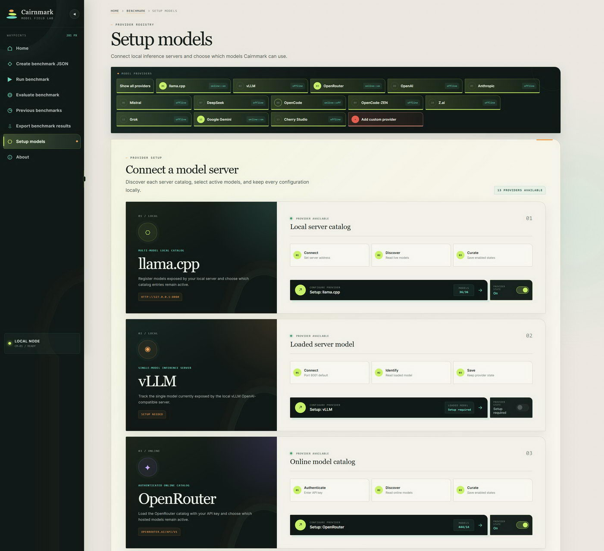
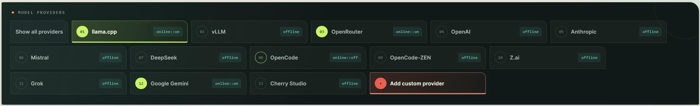
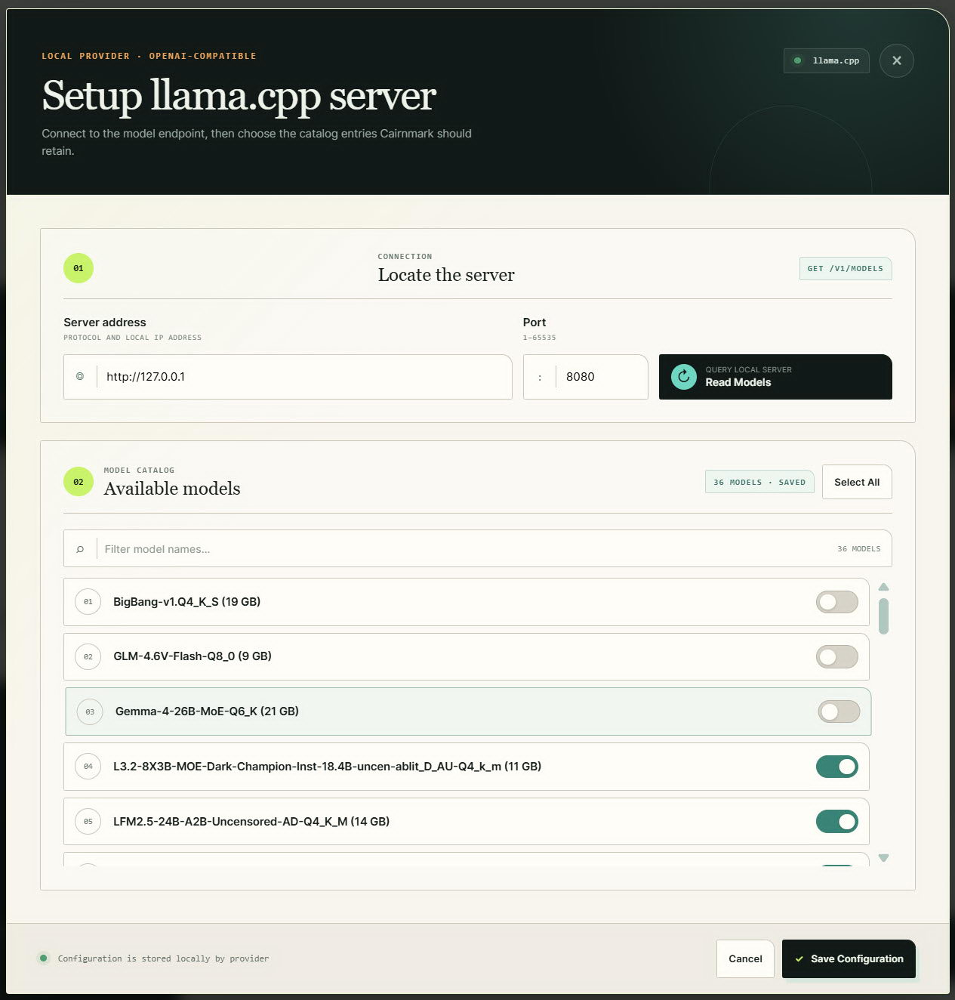
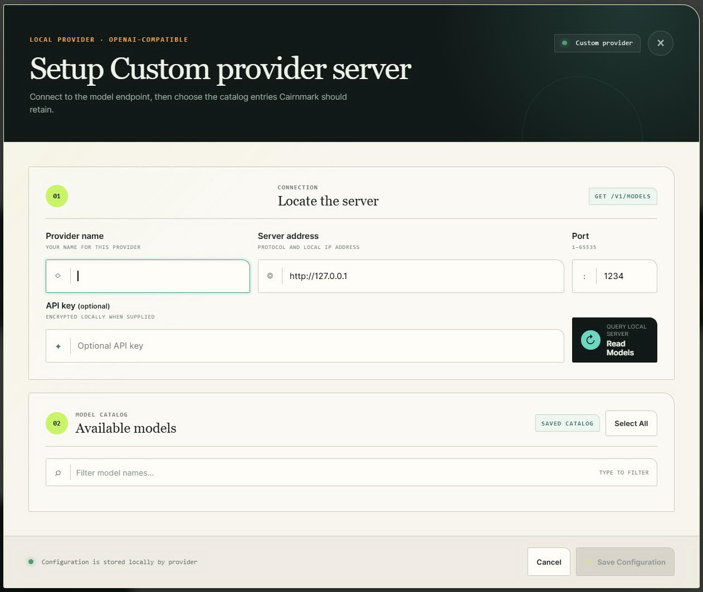
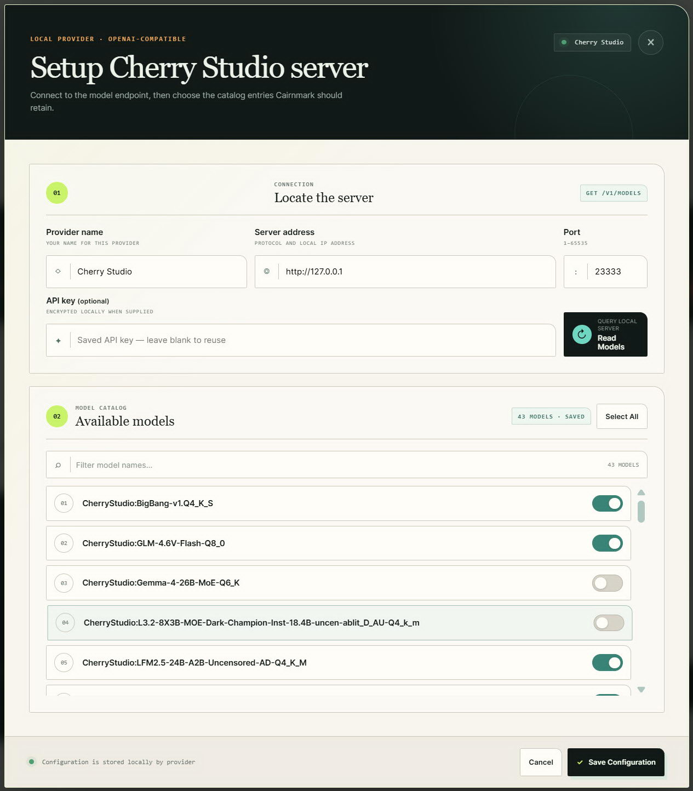
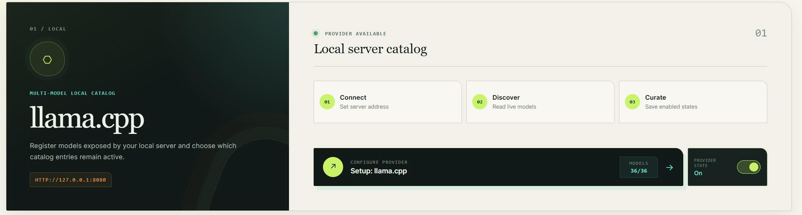

# Model provider setup

---

CairnMark uses one provider workspace for local servers, hosted APIs, and
OpenAI-compatible custom endpoints. A model becomes available to chat and
benchmark pages only when its provider is reachable and both the provider and
model are enabled.

<!-- Screenshot placeholder: replace manual/setup-models.jpg when the setup UI changes. -->

---

## Supported provider types

| Type | Providers | Discovery behavior |
| --- | --- | --- |
| Local multi-model | llama.cpp | Reads the live catalog and saves individual model switches |
| Local single-model | vLLM | Saves the endpoint and reads the currently loaded model live |
| Hosted APIs | OpenRouter, OpenAI, Google Gemini, Anthropic, Mistral, DeepSeek, OpenCode, OpenCode-ZEN, Z.ai, Grok | Uses an API key to read the provider catalog and save model switches |
| Custom | Any compatible local endpoint | Reads an OpenAI-compatible `/v1/models` catalog |

The **Model providers** selector filters the setup cards. The selected filter is
saved immediately and restored on the next visit. **Show all providers** clears
the filter; **Add custom provider** opens the custom-provider dialog without
changing it.

### Provider state marker

The numbered circle in each provider filter gives a compact status summary
without changing the filter button itself:

| Provider state | Numbered circle |
| --- | --- |
| Offline | Inactive appearance |
| Online, provider off | Inactive center with a thin yellow border |
| Online, provider on | Yellow-filled active appearance |

The marker reflects provider reachability and its provider-level switch. Model
switches remain independent and are managed inside the provider setup.

---

| Known provider setup                                                         | Custom setup                                                                 | Custom provider                                                                                       |
|------------------------------------------------------------------------------|------------------------------------------------------------------------------|-------------------------------------------------------------------------------------------------------|
|  |  |  |

---

## Connect a provider

1. Open **Setup models** and choose a provider.
2. Select **Open setup**.
3. Enter the local address and port, or the hosted-provider API key.
4. Select **Read Models**.
5. Enable the catalog entries CairnMark should retain.
6. Select **Save Configuration**.
7. Turn on the provider after its status reports online.

New provider configurations start disabled. If an enabled provider becomes
unreachable, CairnMark turns it off so an unavailable model cannot remain
active accidentally.

 

### Local endpoint examples

Typical local values are:

- llama.cpp: `http://127.0.0.1` and port `8080`;
- vLLM: `http://127.0.0.1` and port `8001`; and
- a desktop OpenAI-compatible server: its displayed host and port, often
  `http://127.0.0.1:1234`.

Use the values reported by the running server. CairnMark remains bound to
localhost even when it contacts another local endpoint.

---

## Add a custom provider

Use **Add custom provider** when a local application exposes an OpenAI-compatible
model catalog and chat-completions API.

1. Enter a unique display name.
2. Enter the server address and port.
3. Add an API key only when that local server requires one.
4. Read the catalog, select models, and save.

---

## API key handling

Hosted-provider keys are encrypted before they are written to
`instance/cairnmark.db`. The encryption key is stored separately in
`.secret/encryption.key`. Saved keys are never returned to browser JavaScript.

Back up `instance/` and `.secret/` together. Restoring only the databases makes
encrypted credentials unreadable.

---

## Model parameters

Local llama.cpp and vLLM models can expose default sampling parameters from a
`/props` endpoint. CairnMark caches those values per `provider::model` in
`instance/parameters.db`. Opening the parameter modal later reads the cache.

Deleting a cached local row makes the next modal open fetch fresh defaults.
Extra modal parameters are session-only; **Save setup** stores only the main
chat fields documented in the **[chat guide](chat.md)**.

---

## Troubleshooting

### A provider cannot be enabled

- Confirm that configuration was saved.
- Check the address, port, API-key type, account permissions, and provider
  availability.
- Read the catalog again after changing credentials.
- For vLLM, confirm that the server currently has a model loaded.

### A model is missing from chat or benchmark pages

- Confirm that the provider is online and enabled.
- Confirm that the model switch is enabled.
- Save the configuration after changing model switches.
- For a live single-model provider, reload after the server changes its model.

### A hosted catalog request fails

Provider errors are intentionally summarized without exposing secrets. Verify
the key belongs to the selected provider; for example, a Groq key is not an xAI
Grok key. Check billing or usage permissions in the provider dashboard when the
key is accepted but catalog access is denied.
